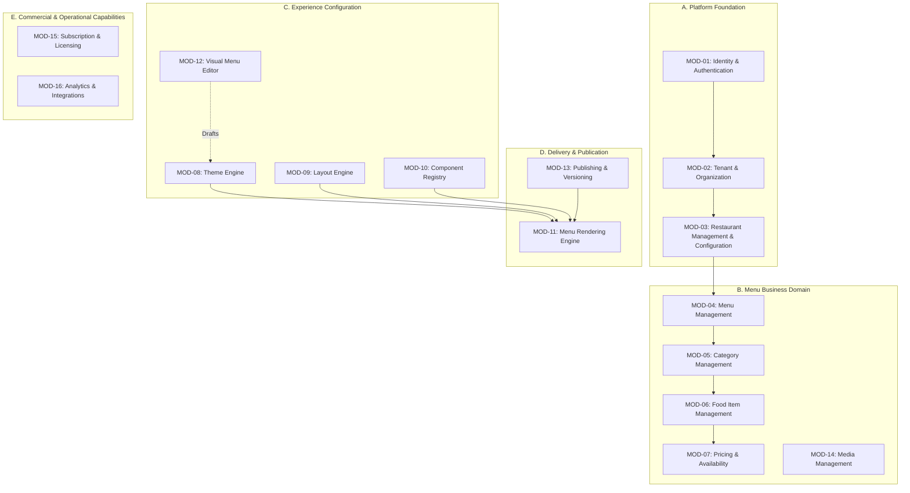

# 01 — Domain Architecture Overview

**Specification:** ARC-04 §4  
**Project:** ModularMenu  

---

## 1. Domain Capability Map

ModularMenu decomposes restaurant operations into five functional capability groups:

---

## 2. Core Architectural Principles
1. **Module Ownership:** Every capability has exactly one authoritative owner. No module exposes raw ORM models or database sessions across boundaries.
2. **Explicit Boundaries:** Modules communicate exclusively via typed Python Protocols and domain events.
3. **Domain-First Design:** Domain logic contains zero dependencies on HTTP frameworks (FastAPI), frontend libraries, or database drivers (SQLAlchemy).
4. **No Premature Microservices:** Modular monolith structure deployed in a unified container process.
