# 06 — Aggregate Boundaries & Consistency Strategy

**Specification:** ARC-04 §7.3  
**Project:** ModularMenu  

---

## 1. Aggregate Root Consistency Boundaries

To prevent locking cascades and unmaintainable God-objects, ModularMenu establishes explicit, localized consistency boundaries:

```mermaid
graph TD
    UserAgg["User Account Aggregate<br/>Root: User"]
    OrgAgg["Organization Aggregate<br/>Root: Organization"]
    RestAgg["Restaurant Aggregate<br/>Root: Restaurant"]
    MenuAgg["Menu Aggregate<br/>Root: Menu"]
    CatAgg["Category Aggregate<br/>Root: Category"]
    FoodAgg["Food Item Aggregate<br/>Root: FoodItem"]
    PriceAgg["Commercial Config Aggregate<br/>Root: Price"]
    ThemeAgg["Theme Definition Aggregate<br/>Root: ThemeDefinition"]
    LayoutAgg["Layout Definition Aggregate<br/>Root: LayoutDefinition"]
    CompAgg["Component Definition Aggregate<br/>Root: ComponentDefinition"]
    DraftAgg["Editor Draft Aggregate<br/>Root: EditorDraft"]
    PubAgg["Publication Aggregate<br/>Root: Publication"]
    MediaAgg["Media Asset Aggregate<br/>Root: MediaAsset"]
    LicAgg["License Aggregate<br/>Root: License"]
```

## 2. Invariant Protection Rules
1. **No Mega-Aggregates:** A `Restaurant` does NOT contain all of its `Menus`, `Categories`, `Dishes`, `Themes`, and `Media`. Each domain concept forms its own aggregate.
2. **References by Identifier:** Aggregates refer to other aggregates by immutable UUID, not direct in-memory object references.
3. **Transaction Scope:** A write operation typically modifies one aggregate root per database transaction. When multi-aggregate atomicity is required (e.g. publication activation), application use cases orchestrate operations within a Unit of Work context.
