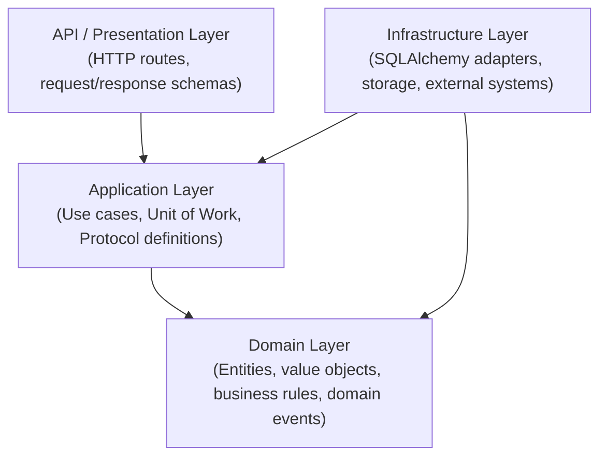

# 08 — Module Dependency Architecture

**Specification:** ARC-04 §9  
**Project:** ModularMenu  

---

## 1. Directional Dependency Rules

The dependency flow in ModularMenu is strictly directional:

## 2. Permitted Collaboration & Prohibitions

| Source Module | Permitted Targets | Strictly Prohibited Targets |
| :--- | :--- | :--- |
| **MOD-01 Identity** | None | Menus, Categories, Publishing, Themes |
| **MOD-02 Organizations**| Identity (Contract) | Menus, Categories, Food Items, Pricing |
| **MOD-03 Restaurants** | Organizations (Contract) | Menus, Categories, Food Items, Publishing |
| **MOD-04 Menus** | Restaurants, Categories (Contract) | Identity, Publishing, Licensing |
| **MOD-05 Categories** | Menus (Contract) | Identity, Publishing |
| **MOD-06 Food Items** | Categories, Media (Contract) | Identity, Publishing |
| **MOD-07 Pricing** | Food Items (Contract) | Identity, Publishing |
| **MOD-08 Themes** | None (Self-contained) | Menus, Food Items, Publishing |
| **MOD-09 Layouts** | Components (Contract) | Menus, Food Items, Publishing |
| **MOD-10 Components** | None (Self-contained registry) | Menus, Editor, Publishing |
| **MOD-11 Rendering** | Themes, Layouts, Components, Publishing | Editor, Identity |
| **MOD-12 Editor** | Themes, Layouts, Components, Menus | Identity |
| **MOD-13 Publishing** | Menus, Categories, Food Items, Pricing, Themes, Layouts | Editor, Identity |
| **MOD-14 Media** | None (Generic storage adapter) | Menus, Publishing |
| **MOD-15 Licensing** | Organizations (Contract) | Menus, Publishing, Rendering |
| **MOD-16 Analytics** | Domain event listeners | Direct writes to core domain tables |

## 3. Automated CI Enforcement
Dependencies are declared in `backend/architecture/module_dependencies.yaml` and continuously validated via AST test `tests/architecture/test_arc04_boundaries.py`. Any prohibited import fails CI immediately.
