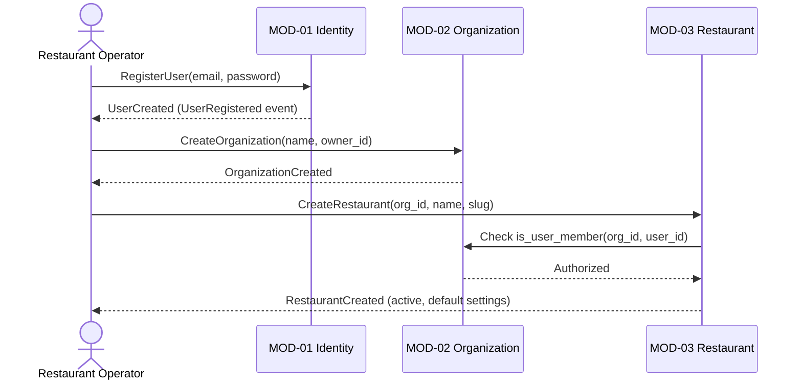
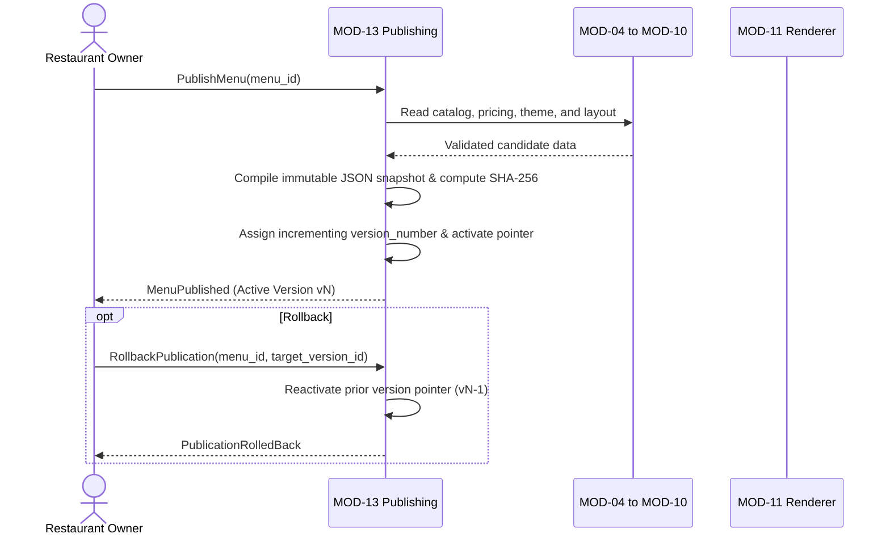

# 10 — Core Business Workflows & Sequences

**Specification:** ARC-04 §10.4, §10.5, §10.6  
**Project:** ModularMenu  

---

## 1. Restaurant Onboarding Workflow (`VAL-ARC04-01`)

---

## 2. Menu Creation & Editing Workflow (`VAL-ARC04-02`)

1. **MOD-04:** Creates menu in `DRAFT` status.
2. **MOD-05:** Creates categories with deterministic `display_order`.
3. **MOD-06:** Creates food items with dietary labels and allergen alerts.
4. **MOD-07:** Configures fixed-precision `Money` prices.
5. **MOD-12:** Coordinates visual studio editor sessions, maintaining reversible draft history (`undo`/`redo`) without mutating published menus.

---

## 3. Publication & Rollback Pipeline (`VAL-ARC04-04`)

