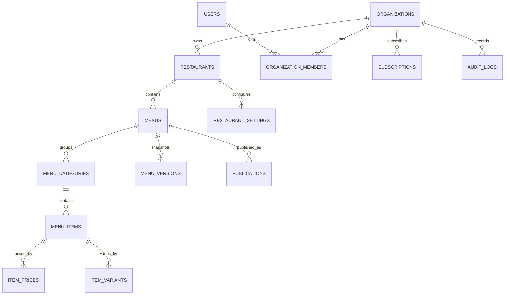

# 04 — Entity-Relationship Diagrams

## 1. Core Relational Diagram

## 2. Composite Relational Links

Composite foreign keys enforce matching ownership across all tiers:
- `menus(organization_id, restaurant_id) -> restaurants(organization_id, id)`
- `menu_categories(organization_id, restaurant_id, menu_id) -> menus(organization_id, restaurant_id, id)`
- `menu_items(organization_id, restaurant_id, category_id) -> menu_categories(organization_id, restaurant_id, id)`
- `item_prices(organization_id, restaurant_id, item_id) -> menu_items(organization_id, restaurant_id, id)`
- `menu_versions(organization_id, restaurant_id, menu_id) -> menus(organization_id, restaurant_id, id)`
- `publications(organization_id, restaurant_id, menu_id, menu_version_id) -> menu_versions(organization_id, restaurant_id, menu_id, id)`
