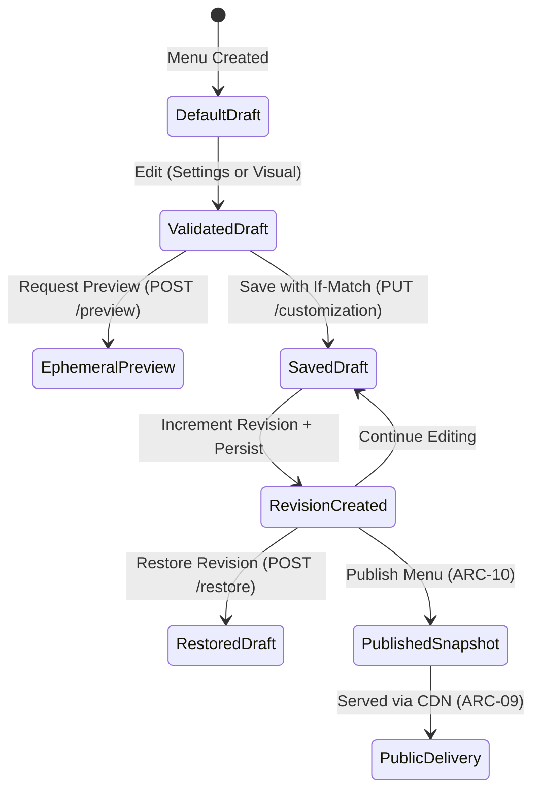

# ARC-08 §3 — Customization Lifecycle & State Machine

### Lifecycle States
- **Draft:** Working customization state stored in `menu_customizations`. Mutable only through optimistic concurrency updates.
- **Revision History:** Immutable historical revisions stored in `customization_revisions`.
- **Ephemeral Preview:** In-memory resolved tokens and component tree generated without persisting to disk.
- **Published Snapshot:** Frozen, immutable customization snapshot embedded in the published menu release (ARC-10), completely decoupled from future draft changes.
