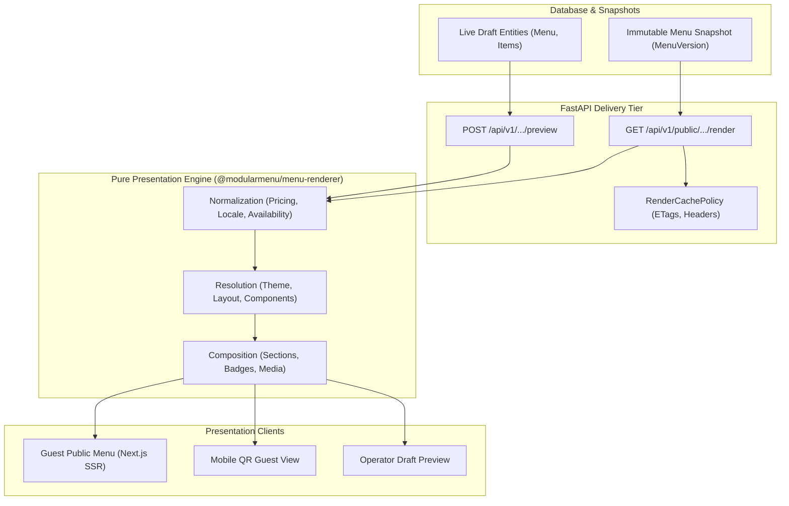

# ARC-09 §01 — Menu Rendering Architecture Overview

## 1. Executive Summary
ARC-09 defines how ModularMenu transforms restaurant content, pricing, categories, and visual customizations into high-performance, responsive, publicly accessible digital menus and authenticated draft previews.

## 2. Core Architectural Model
The menu rendering subsystem operates as a **pure presentation engine**:
1. **Decoupled Engine**: The core rendering pipeline (`packages/menu-renderer/`) is completely decoupled from database access, authentication schemes, and server state. It accepts a canonical `RenderInput` and produces a deterministic `RenderPlan`.
2. **Immutable Snapshots**: Public customer delivery is driven exclusively by immutable published snapshots (`MenuVersion`), preventing draft leaks and achieving sub-10ms response times.
3. **Dual Execution**: Shared rendering rules run on both the server (SSR via Next.js for SEO and fast initial paint) and the client (for interactive category navigation and visual editor previews).
4. **Edge & CDN Cacheable**: Public menus are served with deterministic ETags, cache keys, and cache-control directives enabling global CDN edge distribution.

