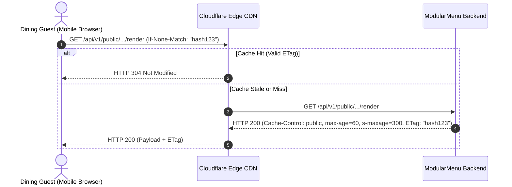

# ARC-09 §09 — Caching, ETag & Invalidation Policy

## 1. Caching Specifications
To support high-concurrency QR code scanning during peak dining hours:

## 2. Header Directives
- **Published Deliveries**:
  - `Cache-Control: public, max-age=60, s-maxage=300, stale-while-revalidate=86400`
  - `ETag: "{sha256_checksum}"`
  - `Vary: Accept-Encoding`
- **Draft Previews**:
  - `Cache-Control: private, no-cache, no-store, must-revalidate`
  - `Pragma: no-cache`
  - `Expires: 0`

## 3. Instant Invalidation
Because the cache key is keyed by the snapshot SHA-256 checksum (`modularmenu:render:{restaurant_slug}:{menu_slug}:{checksum}`), publishing a new version immediately generates a distinct cache key, rendering stale caches automatically bypassed without requiring manual CDN purge calls.
