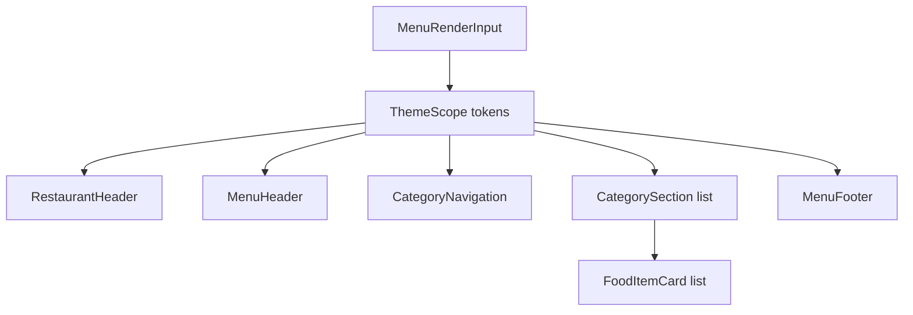

# ARC-09 §14 — Frontend Rendering Engine Architecture

## 1. Directory & Package Structure
The frontend rendering subsystem is structured across two layers:
1. `@modularmenu/menu-renderer` (`packages/menu-renderer/`):
   - Pure TypeScript library.
   - Zero DOM, zero React dependencies.
   - Contains normalization, slot resolution, price formatting, and composition logic.
2. `ModularMenu Frontend` (`frontend/src/features/public-menu/`):
   - Next.js and React presentation components.
   - `PublicMenuRenderer`: Root component scoped with `ThemeScope`.
   - `RestaurantHeader`, `MenuHeader`, `CategoryNavigation`, `CategorySection`, `FoodItemCard`, `MenuFooter`.
   - Server data fetcher: `getPublishedMenu`.

## 2. Component Composition Flow

