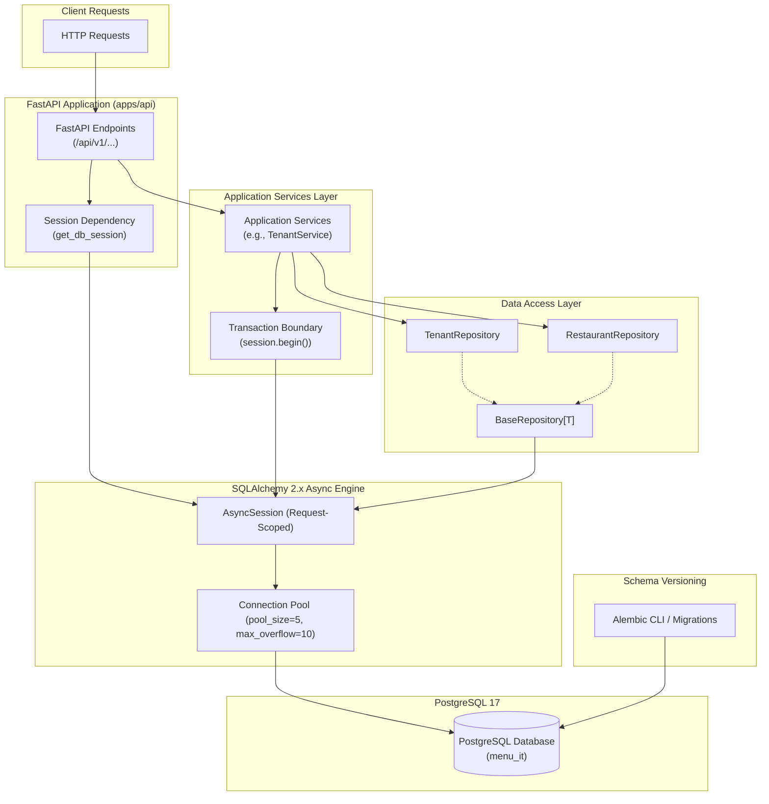
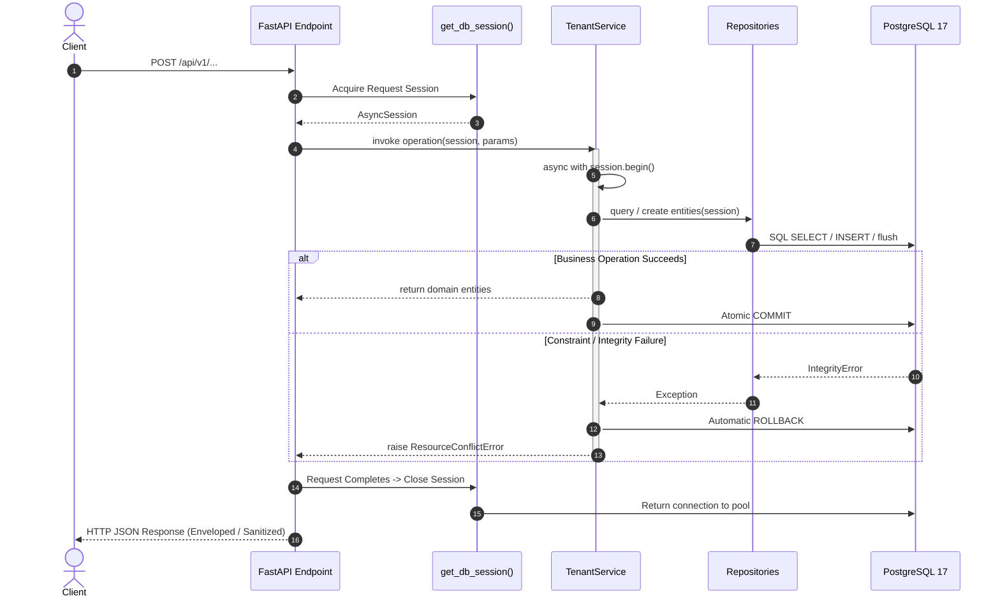

# FCD-03 — Database Architecture & Data Access Foundation

## 1. Architectural Overview

Phase **FCD-03** establishes the persistent relational data layer for the **Menu-It** multi-tenant SaaS platform. It transforms the application skeleton established in FCD-02 into a database-backed system with versioned schemas, connection pooling, request-scoped sessions, repository isolation, and atomic transaction boundaries.

---

## 2. Layer Responsibilities & Invariants

| Layer | Responsibility | Invariants & Exclusions |
| :--- | :--- | :--- |
| **FastAPI Endpoints** | HTTP routing, request parsing, response formatting. | No SQL construction; no direct repository creation without dependency injection. |
| **Application Services** | Orchestrates business workflows, coordinates multi-repository operations, owns transaction boundaries. | Services own `session.begin()`; translates lower-level database exceptions into sanitized domain exceptions. |
| **Repositories** | Encapsulates SQL queries, pagination, filtering, persistence, and deletion. | **Never commits** (`session.commit()` is forbidden); never creates engines or independent sessions. Calls `session.flush()`. |
| **AsyncSession** | Unit of work for database connections within a request lifecycle. | Strictly request-scoped via `get_db_session()`. Automatically disposed/closed upon request completion. |
| **Engine & Pool** | Connection acquisition, pre-ping validation, connection recycling, timeout management. | Application-global singleton managed through `apps/api/src/menu_it/database/engine.py`. Disposed on app shutdown. |
| **PostgreSQL 17** | Relational data persistence, foreign key enforcement, index management, constraints. | Authoritative source of data integrity and uniqueness. |
| **Alembic** | Version-controlled, reproducible schema migrations. | Sole approved mechanism for structural database schema changes in production. |

---

## 3. Request Execution Flow

