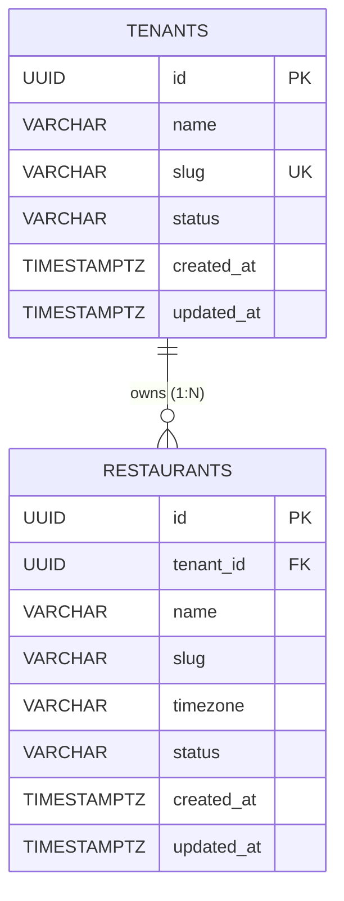

# FCD-03 — Relational Schema Design & Conventions

## 1. Schema Conventions & Metadata

All database entities in Menu-It inherit from `Base` in `apps/api/src/menu_it/database/base.py`, enforcing standardized constraint naming conventions:

```python
NAMING_CONVENTION = {
    "ix": "ix_%(table_name)s_%(column_0_name)s",
    "uq": "uq_%(table_name)s_%(column_0_name)s",
    "ck": "ck_%(table_name)s_%(constraint_name)s",
    "fk": "fk_%(table_name)s_%(column_0_name)s_%(referred_table_name)s",
    "pk": "pk_%(table_name)s",
}
```

### Universal Rules
- **Primary Keys:** UUID v4 (`UUID(as_uuid=True)`), generated via `uuid.uuid4`.
- **Timestamps:** UTC-aware `TIMESTAMPTZ` with `server_default=func.now()` and `onupdate=func.now()`.
- **Table Names:** Plural snake_case (`tenants`, `restaurants`).
- **Column Names:** Snake_case.
- **Foreign Keys:** Explicitly named constraints with restrictive delete policies (`ondelete="RESTRICT"`).

---

## 2. Entity Relationship Diagram



---

## 3. Table Specifications

### 3.1 `tenants` Table

| Column | Type | Nullable | Default | Constraints | Description |
| :--- | :--- | :--- | :--- | :--- | :--- |
| `id` | `UUID` | No | `uuid.uuid4()` | `pk_tenants` (PK) | Unique tenant identifier |
| `name` | `VARCHAR(160)` | No | — | — | Human-readable organization name |
| `slug` | `VARCHAR(100)` | No | — | `uq_tenants_slug`, `ix_tenants_slug` | URL-safe globally unique identifier |
| `status` | `VARCHAR(16)` / Enum | No | `'active'` | `tenant_status` enum | Lifecycle state (`active`, `suspended`, `inactive`) |
| `created_at` | `TIMESTAMPTZ` | No | `CURRENT_TIMESTAMP` | — | Record creation timestamp |
| `updated_at` | `TIMESTAMPTZ` | No | `CURRENT_TIMESTAMP` | — | Record last update timestamp |

### 3.2 `restaurants` Table

| Column | Type | Nullable | Default | Constraints | Description |
| :--- | :--- | :--- | :--- | :--- | :--- |
| `id` | `UUID` | No | `uuid.uuid4()` | `pk_restaurants` (PK) | Unique restaurant identifier |
| `tenant_id` | `UUID` | No | — | `fk_restaurants_tenant_id_tenants`, `ix_restaurants_tenant_id` | Foreign key referencing `tenants.id` (`ondelete=RESTRICT`) |
| `name` | `VARCHAR(160)` | No | — | — | Restaurant location name |
| `slug` | `VARCHAR(100)` | No | — | Part of `uq_restaurants_tenant_id_slug` | Tenant-scoped location slug |
| `timezone` | `VARCHAR(64)` | No | `'UTC'` | — | IANA timezone designation |
| `status` | `VARCHAR(16)` / Enum | No | `'active'` | `restaurant_status` enum | Operating state (`active`, `inactive`, `closed`) |
| `created_at` | `TIMESTAMPTZ` | No | `CURRENT_TIMESTAMP` | — | Record creation timestamp |
| `updated_at` | `TIMESTAMPTZ` | No | `CURRENT_TIMESTAMP` | — | Record last update timestamp |

> [!NOTE]
> Composite uniqueness `(tenant_id, slug)` allows distinct tenants to each operate a branch named `downtown`, while preventing duplicate slugs within the same tenant.
