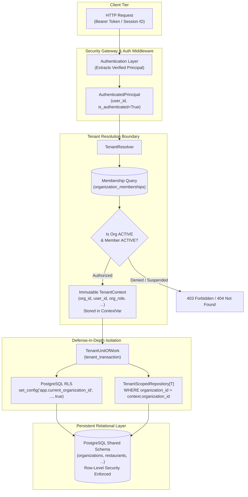

# FCD-04 — Multi-Tenant Architecture & Trust Boundaries

## 1. Architectural Overview & Invariants

Phase **FCD-04** establishes the multi-tenant architecture for the **Menu-It** restaurant SaaS platform. It establishes how the platform identifies organizations, resolves memberships, enforces an immutable request-scoped tenant context, and isolates tenant data across shared infrastructure.

### Core Security Invariant
> **A tenant is identified exclusively by trusted server-side identity and active membership resolution — NEVER by a tenant identifier supplied directly by the client.**

Under no circumstances may a user access or mutate an organization's data simply by manipulating an `organization_id`, URL parameter, query parameter, request body property, or HTTP header.

---

## 2. Trust Boundaries & Anti-Spoofing Guarantees

1. **Untrusted Client Inputs**:
   - `organization_id` route parameters are treated purely as *target resource identifiers*, not authority credentials.
   - Any client-submitted header purporting to declare tenant ownership (such as `X-Tenant-ID` or `X-Organization-ID`) is completely ignored by the tenant resolution pipeline.
2. **Trusted Authentication**:
   - The user identity is established via cryptographic tokens or server sessions into an `AuthenticatedPrincipal`.
3. **Database-Backed Membership Validation**:
   - The `TenantResolver` executes a query against `organization_memberships` verifying that `user_id` is an active member of `organization_id`.
4. **Context Immutability**:
   - Once resolved, the `TenantContext` is encapsulated as a frozen dataclass and placed into Python's `contextvars.ContextVar`.
5. **Defense-in-Depth Isolation**:
   - **Application Layer**: `TenantScopedRepository[T]` programmatically enforces `WHERE organization_id = :context_org_id` on all read and write queries.
   - **Database Layer**: PostgreSQL Row-Level Security (RLS) policies enforce row-level access control on all tenant-owned tables via transaction-local configuration `app.current_organization_id`.
