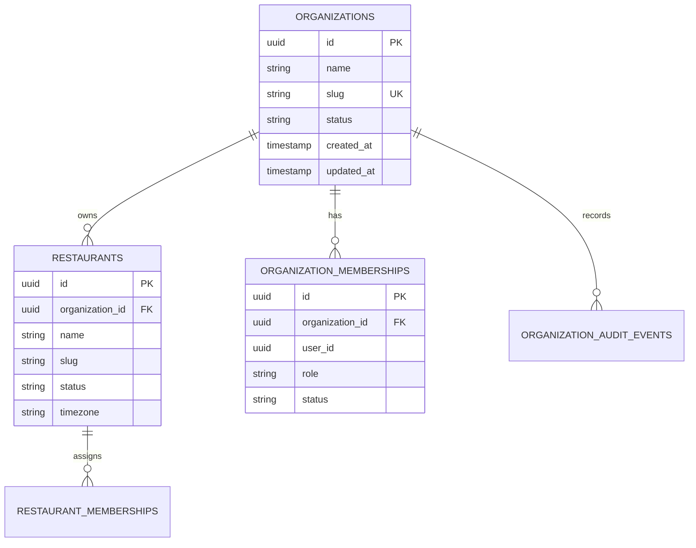

# FCD-04 — Organization Ownership & Schema Reconciliation

## 1. Canonical Organization Entity

In Menu-It, the **Organization** represents the primary tenant boundary. An organization owns subscriptions, billing accounts, staff memberships, and one or more subordinate restaurants or branches.

### Reconciliation from FCD-03
In phase FCD-03, initial tables were provisioned as `tenants` and `restaurants.tenant_id`.
In alignment with Menu-It ARC-05 architecture, FCD-04 reconciles these names to the canonical schema:
- Renamed table `tenants` -> `organizations`.
- Renamed foreign key column `restaurants.tenant_id` -> `restaurants.organization_id`.
- Updated all constraints, foreign keys, and indexes to `organization_id`.
- Maintained backward-compatibility aliases in Python models (`Tenant = Organization`, `Restaurant.tenant_id = synonym("organization_id")`).

---

## 2. Organization Schema Definition

```sql
CREATE TABLE organizations (
    id UUID PRIMARY KEY DEFAULT gen_random_uuid(),
    name VARCHAR(120) NOT NULL,
    slug VARCHAR(63) NOT NULL,
    status VARCHAR(32) NOT NULL DEFAULT 'provisioning',
    created_at TIMESTAMPTZ NOT NULL DEFAULT clock_timestamp(),
    updated_at TIMESTAMPTZ NOT NULL DEFAULT clock_timestamp(),
    CONSTRAINT uq_organizations_slug UNIQUE (slug)
);

CREATE INDEX ix_organizations_status ON organizations (status);
```

### Key Field Descriptions
- **`id` (UUID)**: Universally unique primary key, immune to sequential enumeration attacks.
- **`name` (VARCHAR)**: Human-readable corporate or brand title.
- **`slug` (VARCHAR)**: Unique, URL-safe tenant identifier (e.g., `the-rustic-spoon`).
- **`status` (VARCHAR)**: Governed by `OrganizationStatus` state machine (`provisioning`, `active`, `suspended`, `offboarding`, `deactivated`).
- **`created_at` / `updated_at`**: Monotonic UTC audit timestamps managed via `TimestampMixin`.

---

## 3. Subordinate Ownership Model

All subordinate business records (restaurants, menus, orders, audit records) reference `organization_id`:



Foreign keys enforce `ON DELETE RESTRICT` to prevent accidental orphaned business data or unauthorized cascade deletions.
