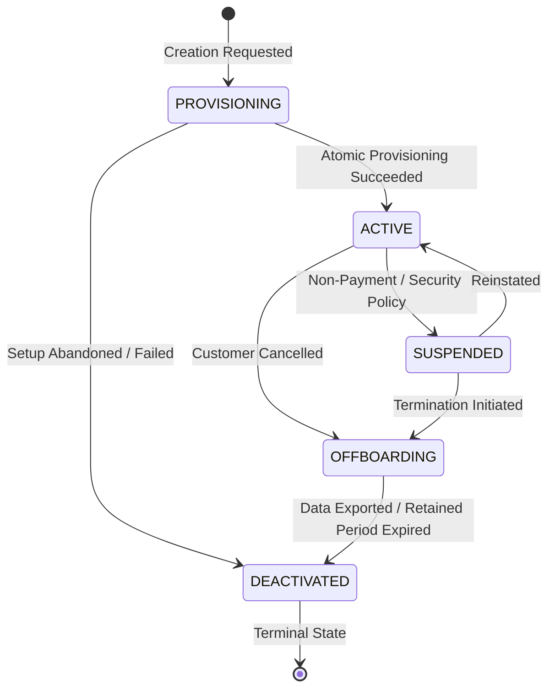

# FCD-04 — Tenant & Restaurant Lifecycle Management

## 1. Lifecycle State Machine Overview

Tenants (Organizations) and Restaurants progress through explicit, deterministic lifecycle states. Invalid transitions are strictly rejected by domain validation.



---

## 2. Organization States (`OrganizationStatus`)

- **`PROVISIONING`**: Organization record created; initial membership, billing setup, or primary restaurant are being configured. Cannot process operational menu/order requests.
- **`ACTIVE`**: Fully operational tenant in good standing. All endpoints available to authorized members.
- **`SUSPENDED`**: Temporarily disabled (e.g. overdue invoice or abuse review). Members attempting API access receive HTTP 403 Forbidden.
- **`OFFBOARDING`**: Tenant has requested departure. In grace period for data export; writes rejected.
- **`DEACTIVATED`**: Terminal inactive state. Database records soft-deleted or archived; all user access permanently denied.

### Transition Rules
```python
ALLOWED_TRANSITIONS: dict[OrganizationStatus, set[OrganizationStatus]] = {
    OrganizationStatus.PROVISIONING: {
        OrganizationStatus.ACTIVE,
        OrganizationStatus.DEACTIVATED,
    },
    OrganizationStatus.ACTIVE: {
        OrganizationStatus.SUSPENDED,
        OrganizationStatus.OFFBOARDING,
    },
    OrganizationStatus.SUSPENDED: {
        OrganizationStatus.ACTIVE,
        OrganizationStatus.OFFBOARDING,
    },
    OrganizationStatus.OFFBOARDING: {
        OrganizationStatus.DEACTIVATED,
    },
    OrganizationStatus.DEACTIVATED: set(),  # Terminal
}
```

---

## 3. Restaurant States (`RestaurantStatus`)

Individual restaurants within an active organization follow a subordinate lifecycle:
- **`ACTIVE`**: Open for customer orders and operations.
- **`INACTIVE`**: Temporarily closed (e.g., renovations, seasonal pause).
- **`SUSPENDED`**: Suspended independently by organization owners or platform admins.
- **`ARCHIVED`**: Terminal historical archive.
