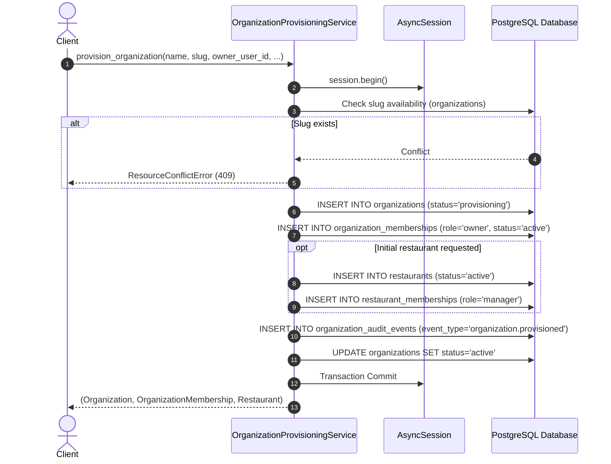

# FCD-04 — Tenant Provisioning & Offboarding Primitives

## 1. Atomic Organization Provisioning

Tenant onboarding involves creating multiple related database records across tables (`organizations`, `organization_memberships`, `restaurants`, `restaurant_memberships`, and `organization_audit_events`).

If any step fails (e.g. duplicate slug, database constraint violation, network glitch), partial tenant state must never remain orphaned in the database.

### `OrganizationProvisioningService`
The provisioning service runs entirely within an explicit atomic transaction:

---

## 2. Offboarding & Data Deletion Primitives

Offboarding proceeds through structured phases:
1. **Initiate Offboarding**: Transition organization to `OFFBOARDING`. Prevents all modifications and new orders while allowing export jobs.
2. **Data Retention Window**: 30-day grace period where tenant administrators can request JSON/CSV data archives.
3. **Deactivation**: Transition to `DEACTIVATED`. API access is revoked; external integrations and webhooks are disabled.
4. **Purge / Scrub**: Scheduled batch workers sanitize personally identifiable customer data (PII) in compliance with privacy regulations.
