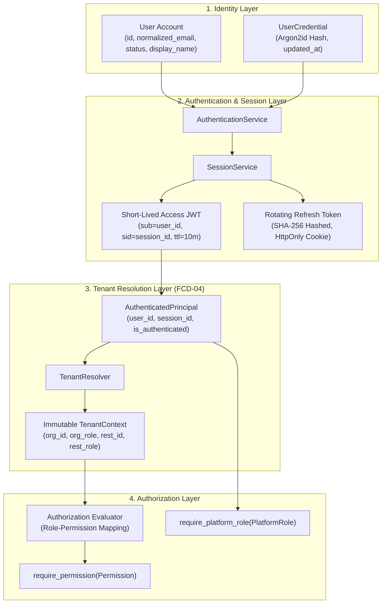

# FCD-05 — Identity Architecture & Trust Boundaries

## 1. Architectural Overview & Separation of Concerns

Phase **FCD-05** builds the identity, credential, authentication, session, verification, recovery, permission, and access-control infrastructure for the **Menu-It** multi-tenant SaaS platform.

It builds directly upon the organization-centric multi-tenant foundation established in **FCD-04**.

### Core Architectural Principle
A secure SaaS system separates five fundamental concerns:
1. **Identity:** *Who is the user?* (`User`, `UserStatus`, verified email, unique immutable identifier).
2. **Authentication:** *Can the user prove their identity?* (Argon2id password verification, cryptographic access tokens).
3. **Session Management:** *Is the user's active session still valid?* (`UserSession`, opaque rotating refresh tokens with automatic reuse detection, device tracking, revocation).
4. **Tenant Access:** *Which organization and restaurant can the user access?* (FCD-04 server-side `TenantResolver`, trusted `OrganizationMembership`, immutable `TenantContext`).
5. **Authorization:** *What is the user allowed to do?* (Fine-grained `Permission` vocabulary, role-permission matrices, `require_permission` dependency gating).

---

## 2. Security Invariants

1. **Decoupled Identity:** A user account exists as an independent entity, entirely distinct from any organization memberships. Deleting or leaving an organization never destroys a user's identity account.
2. **Zero-Trust Client Identity:** Tenant and platform privileges are never derived from client claims, JWT headers, or URL parameters. Every authorization decision resolves server-side membership records in real time.
3. **Constant-Time Verification:** Credential verification executes in constant time using dummy work to eliminate timing-based account enumeration attacks.
4. **Session-Bound Tokens:** Access tokens are strictly bound to a database-backed session (`sid`). Revoking a session immediately invalidates the access token at the security gateway.
5. **Token Family Rotation & Reuse Detection:** Presenting an already-consumed refresh token immediately triggers automated family revocation and session termination, defending against token theft.
