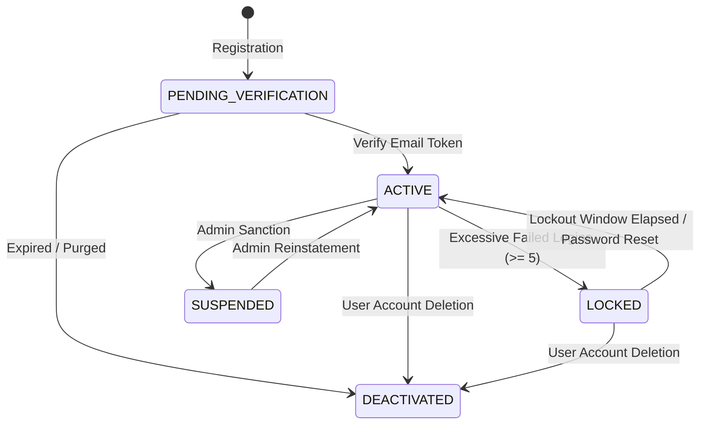

# FCD-05 — User Account Model & Identity Lifecycle

## 1. Domain Entities & Schema Definition

The `User` model represents a human user within the Menu-It ecosystem. It is defined in [user.py](file:///c:/Users/ASUS/Documents/Menu-it/apps/api/src/menu_it/database/models/user.py) and persisted in the `users` table.



### Table Definition: `users`

| Column | Type | Constraints | Description |
|---|---|---|---|
| `id` | `UUID` | Primary Key, Default UUIDv4 | Unique immutable identity identifier |
| `email` | `VARCHAR(320)` | Not Null | Display email address as supplied by user |
| `normalized_email` | `VARCHAR(320)` | Unique, Not Null, Index | Canonical lowercase normalized email (`strip().casefold()`) |
| `display_name` | `VARCHAR(160)` | Not Null | User's full name or greeting name |
| `email_verified` | `BOOLEAN` | Not Null, Default `False` | Whether ownership of email has been cryptographically confirmed |
| `status` | `VARCHAR(32)` | Not Null, Default `pending_verification` | Lifecycle state (`UserStatus` StrEnum) |
| `failed_login_attempts` | `INTEGER` | Not Null, Default `0` | Consecutive failed password verification attempts |
| `locked_until` | `TIMESTAMPTZ` | Nullable | Expiration timestamp for temporary lockout window |
| `created_at` | `TIMESTAMPTZ` | Not Null, Server Default UTC | Account creation timestamp |
| `updated_at` | `TIMESTAMPTZ` | Not Null, Server Default UTC | Last update timestamp |

---

## 2. Email Normalization Standards

To prevent account collision and duplicate account bypasses, all incoming email addresses undergo strict normalization:
```python
def normalize_email(email: str) -> str:
    normalized = email.strip().casefold()
    if not normalized:
        raise ValueError("Email is required.")
    return normalized
```
This guarantees that `John.Doe@EXAMPLE.COM`, `john.doe@example.com`, and `  john.doe@example.com  ` map to the identical account record.
