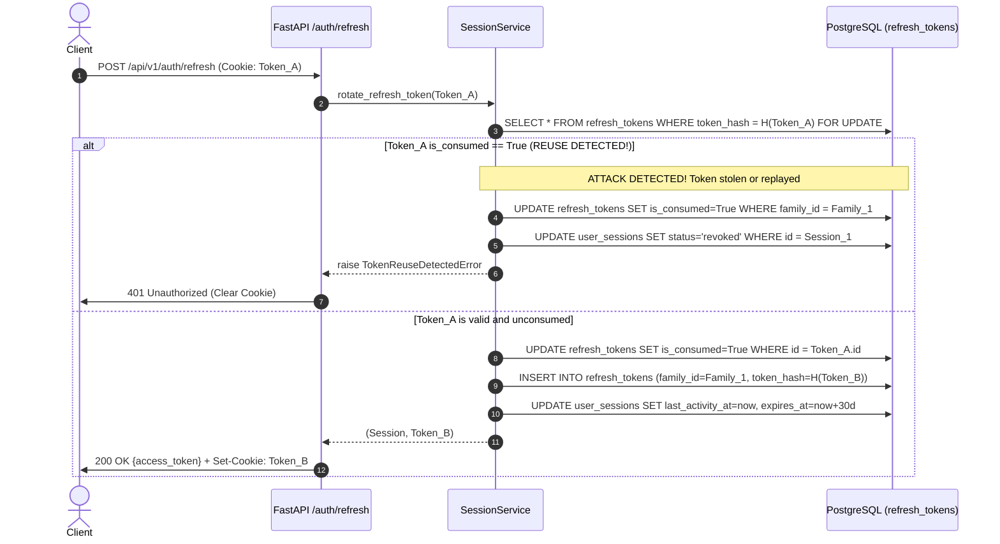

# FCD-05 — Session Management & Refresh Token Rotation

## 1. Refresh Token Rotation & Family Tracking

Menu-It implements automatic refresh token rotation adhering to RFC 6819 §5.2.2.3. Every time a refresh token is presented to `/api/v1/auth/refresh`:
1. The token hash is looked up with pessimistic row locking (`SELECT ... FOR UPDATE`).
2. If the token was already consumed (`is_consumed == True`), **token reuse is detected**.
3. The presented token is marked as consumed (`is_consumed = True`).
4. A brand new refresh token is issued within the **same token family** (`family_id`).
5. A new access token is minted and returned.
6. The session expiration is extended (sliding window).

---

## 2. Session Lifecycle States

The `UserSession` model tracks client devices, IP addresses, and operational states:
- `active`: Valid session authorized to access the system and rotate tokens.
- `revoked`: Session manually revoked by user, administrator, or security policy.
- `expired`: Session idle window or maximum lifetime elapsed.

### Revocation Guarantees
- Single session logout (`POST /api/v1/auth/logout`) immediately revokes the target session.
- Global logout (`POST /api/v1/auth/logout-all`) revokes all active sessions for that user across all devices.
- Password change or reset automatically triggers revocation of all existing sessions, terminating potential adversary access across stolen devices.
