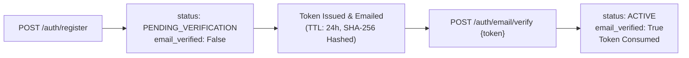

# FCD-05 — Email Verification Workflow

## 1. Objectives & Account Activation

Email verification ensures that a newly registered user actually possesses access to the declared email address, preventing account impersonation and fraudulent signups.

### Lifecycle Transition
Upon successful self-service registration via `/api/v1/auth/register`, the account is created in `status = UserStatus.PENDING_VERIFICATION` with `email_verified = False`.

When the user clicks the verification link or submits the token:

---

## 2. Token Security Invariants

1. **High Entropy:** Tokens are 48-byte URL-safe strings (`secrets.token_urlsafe(48)`).
2. **One-Time Consumption:** Persisted in `email_verification_tokens` table with `consumed_at TIMESTAMPTZ`. Any subsequent attempt to present the same token fails with `InvalidVerificationTokenError`.
3. **Time-To-Live (TTL):** Standard token TTL is 24 hours (`86400` seconds). Expired tokens are rejected.
4. **Idempotent Resending:** `POST /api/v1/auth/email/resend` generates a fresh verification token only if the user exists and is unverified. If the user is already verified or does not exist, it completes with a generic success response without leaking registration state.
