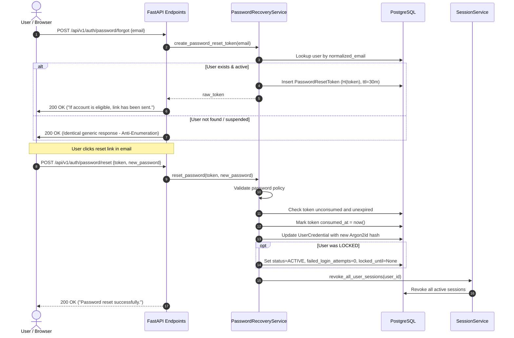

# FCD-05 — Password Recovery & Credential Reset

## 1. Password Reset Workflow

---

## 2. Security Safeguards

1. **Short Token Lifetime:** Reset tokens expire after 30 minutes (`1800` seconds).
2. **Account Unlock Guarantee:** Resetting password automatically unlocks an account locked by brute-force attempts.
3. **Total Session Revocation:** Upon password reset, all active sessions across all devices are immediately marked `REVOKED`, ensuring a compromised device or active token cannot maintain persistence.
4. **Anti-Enumeration Response:** Submitting an unregistered or inactive email to `/auth/password/forgot` returns HTTP 200 with an identical message, giving an attacker no insight into account existence.
