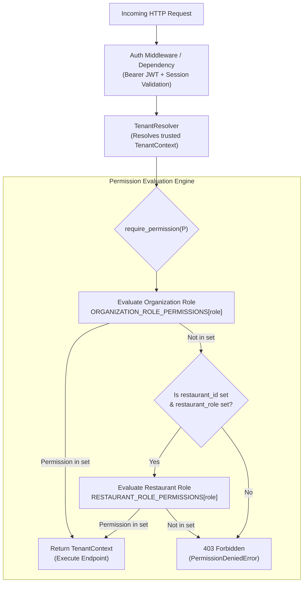

# FCD-05 — Authorization Engine & Policy Evaluator

## 1. Authorization Architecture

The authorization engine in Menu-It operates as a zero-trust policy evaluation layer. It is implemented across:
- [policies.py](file:///c:/Users/ASUS/Documents/Menu-it/apps/api/src/menu_it/authorization/policies.py): Static mapping tables defining role capabilities.
- [evaluator.py](file:///c:/Users/ASUS/Documents/Menu-it/apps/api/src/menu_it/authorization/evaluator.py): Pure evaluation functions (`has_organization_permission`, `require_organization_permission`, etc.).
- [dependencies.py](file:///c:/Users/ASUS/Documents/Menu-it/apps/api/src/menu_it/authorization/dependencies.py): FastAPI dependency factories (`require_permission`, `require_platform_role`).



---

## 2. Declarative Route Protection

Endpoints declare permission requirements cleanly via dependency injection:
```python
@router.delete(
    "/{organization_id}/restaurants/{restaurant_id}",
    dependencies=[Depends(require_permission(Permission.RESTAURANT_ARCHIVE))],
)
async def archive_restaurant(...) -> ...:
    ...
```
This guarantees that developers cannot accidentally forget authorization checks, and every request is validated against the active server-resolved membership before the endpoint function is invoked.
