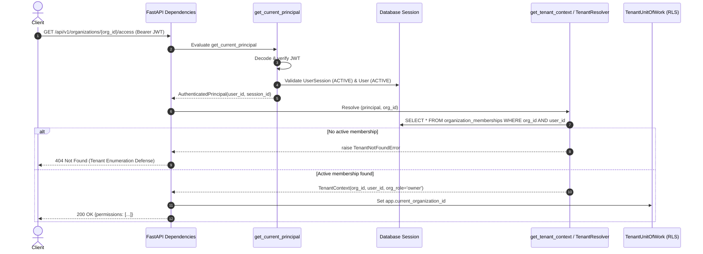

# FCD-05 — Tenant-Authentication Integration

## 1. Bridging Authenticated Principal and Multi-Tenant Resolver

FCD-05 seamlessly integrates the authentication layer with FCD-04's multi-tenant engine through `AuthenticatedPrincipal`.

### Handshake Sequence
1. **Extraction & Cryptographic Verification:** `get_current_principal` dependency extracts the Bearer token from the `Authorization` header, decodes the claims, verifies the signature, and ensures token is unexpired.
2. **Session Liveness Check:** The session ID (`sid`) is checked against the database (`UserSession`). If the session has been revoked or expired, the request is rejected immediately with HTTP 401.
3. **Identity Status Check:** The user account (`sub`) is validated to ensure status is `ACTIVE` (or `PENDING_VERIFICATION`).
4. **Principal Construction:** An immutable `AuthenticatedPrincipal(user_id=..., session_id=..., is_authenticated=True)` is passed to `get_tenant_context`.
5. **Tenant Membership Resolution:** FCD-04's `TenantResolver` queries `organization_memberships` for `(organization_id, principal.user_id)`.
6. **Tenant Context Establishment:** The verified `TenantContext` is instantiated, set into `ContextVar`, and made available to repositories and PostgreSQL Row-Level Security (`app.current_organization_id`).

