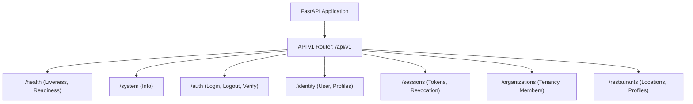

# FCD-07 §03 — Router Tree & Resource Hierarchy

## 1. Modular Router Architecture

Menu-It implements a domain-oriented modular router hierarchy under `/api/v1`. Rather than accumulating route handlers in a flat namespace, each functional module declares its own router with strictly isolated schemas and dependencies.

---

## 2. Router Mounting Specifications

| Prefix | Domain Package | Purpose | Auth Required | Tenant Scoped |
| :--- | :--- | :--- | :--- | :--- |
| `/api/v1/health` | `api.v1.endpoints.health` | System health, liveness and readiness | No | No |
| `/api/v1/system` | `api.v1.endpoints.system` | Non-sensitive build and version metadata | No | No |
| `/api/v1/auth` | `api.v1.endpoints.auth` | Registration, credential login, password recovery | No / Partial | No |
| `/api/v1/identity` | `api.v1.endpoints.identity` | User profile, security credentials | Yes | No |
| `/api/v1/sessions` | `api.v1.endpoints.sessions` | Session management, refresh token rotation | Yes | No |
| `/api/v1/organizations` | `api.v1.endpoints.organizations`| Organization lifecycle, memberships, roles | Yes | Partial |
| `/api/v1/restaurants` | `api.v1.modules.restaurants` | Restaurant creation, listing, configuration | Yes | Yes (Org & Restaurant) |

---

## 3. Extensibility for Future Modules

Future business modules (e.g. menus, tables, orders, kitchen display, billing) follow the same domain package structure:
- `apps/api/src/menu_it/api/v1/modules/<module_name>/router.py`
- `apps/api/src/menu_it/api/v1/modules/<module_name>/schemas.py`
Mounted cleanly via `api_router.include_router(..., prefix="/<module_name>", tags=["<ModuleName>"])`.
