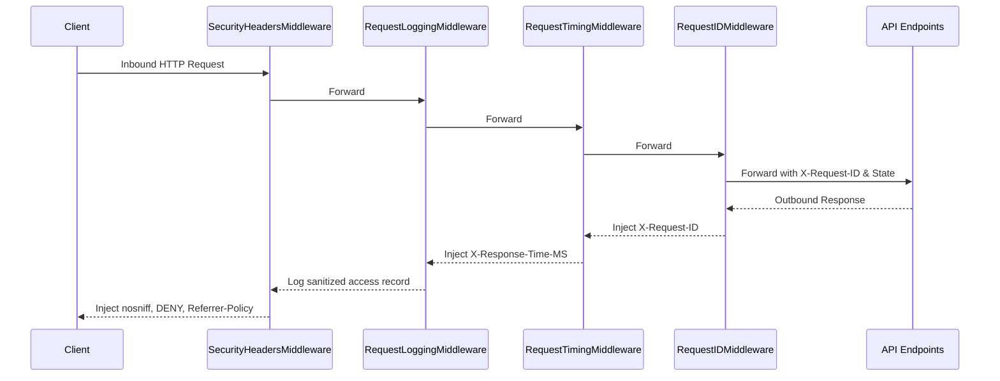

# FCD-07 §05 — Middleware Pipeline Architecture

## 1. Middleware Execution Order

Middlewares in FastAPI execute in reverse order of addition on incoming requests, and standard order on outgoing responses. The pipeline is configured in `apps/api/src/menu_it/application.py`:

---

## 2. Middleware Responsibilities

### RequestIDMiddleware
- Extracts incoming `X-Request-ID` header.
- Validates that it conforms to UUID syntax. If invalid or missing, generates a fresh `UUID4`.
- Stores `request.state.request_id` for downstream logging and dependency injection.
- Guarantees `X-Request-ID` is present on every HTTP response.

### RequestTimingMiddleware
- Measures request processing duration in milliseconds using high-precision monotonic clock (`time.perf_counter()`).
- Injects `X-Response-Time-MS` header in the response.

### SecurityHeadersMiddleware
- Enforces defense-in-depth HTTP security headers:
  - `X-Content-Type-Options: nosniff`
  - `X-Frame-Options: DENY`
  - `Referrer-Policy: strict-origin-when-cross-origin`

### RequestLoggingMiddleware
- Logs structured request and response telemetry (`method`, `path`, `status_code`, `request_id`, `duration_ms`).
- Automatically redacts sensitive headers (such as `Authorization`, `Cookie`, `X-User-ID`, `X-Refresh-Token`).
