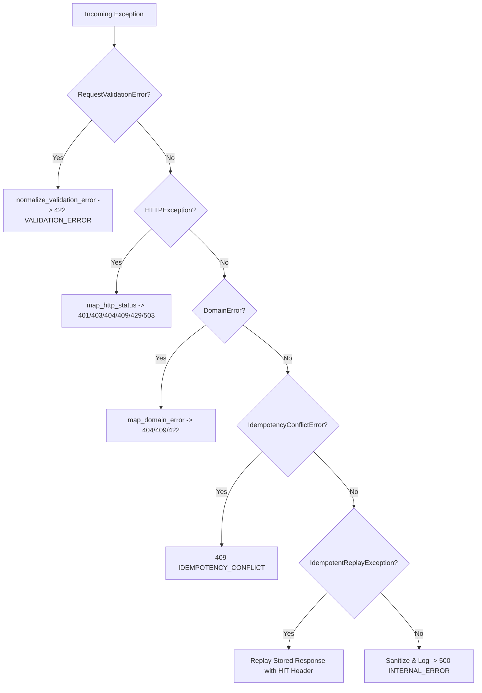

# FCD-07 §06 — Centralized Exception Handling & Domain Error Mapping

## 1. Exception Hierarchy & Response Strategy

The exception architecture provides centralized normalization of every failure into an RFC-aligned envelope without exposing internal tracebacks or private database schema details.

---

## 2. Domain Error Mappings

| Domain Exception | HTTP Status | Public Error Code | Typical Cause |
| :--- | :--- | :--- | :--- |
| `EntityNotFoundError` | 404 Not Found | `RESOURCE_NOT_FOUND` | Missing restaurant, organization, or user |
| `InvalidStateTransitionError` | 409 Conflict | `INVALID_STATE_TRANSITION` | Transitioning entity to disallowed status |
| `BusinessRuleViolationError` | 409 Conflict | `RESOURCE_CONFLICT` | Modifying locked resource, rule invariant failed |
| `ConcurrencyConflictError` | 409 Conflict | `RESOURCE_CONFLICT` | Stale version optimistic lock mismatch |
| `ValidationDomainError` | 422 Unprocessable Entity | `VALIDATION_ERROR` | Domain invariant (e.g. invalid currency, phone) |
| `IdempotencyConflictError` | 409 Conflict | `IDEMPOTENCY_CONFLICT` | Reusing idempotency key with different payload |

---

## 3. Defense Against Information Leakage

Unhandled exceptions (`Exception`) are logged server-side with full stack traces, but client responses receive a generic message (`"An unexpected server error occurred."`) with code `INTERNAL_ERROR` and the request correlation ID for tracing.
