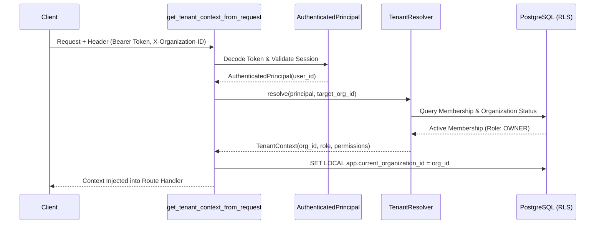

# FCD-07 §08 — Tenant Context Resolution & Request Scoping

## 1. Zero-Trust Identity Principle

A core security invariant of Menu-It established in FCD-04 and enforced in FCD-07 is:
**A tenant context is never derived from client input alone.**

A client cannot gain access to an organization merely by supplying an `organization_id` in headers or request bodies. The server:
1. Validates the caller's authenticated identity (`AuthenticatedPrincipal`).
2. Confirms active, unexpired session in `user_sessions`.
3. Verifies active membership in the target organization (`OrganizationMembership`).
4. Checks organization status is `ACTIVE` (not `SUSPENDED` or `ARCHIVED`).
5. Establishes an immutable, request-scoped `TenantContext`.
6. Sets PostgreSQL session variable `app.current_organization_id` for Row-Level Security (RLS).

---

## 2. Request Scoping Sequence

---

## 3. Defense Against Cross-Tenant Infiltration

Cross-tenant data queries are blocked at two independent architectural layers:
1. **Application Layer:** Repositories filter explicitly with `where(Entity.organization_id == tenant.organization_id)`.
2. **Database Layer:** PostgreSQL RLS policies enforce `organization_id = NULLIF(current_setting('app.current_organization_id', true), '')::uuid`.
Attempting to read or write a cross-tenant resource results in `404 Not Found` (preventing existence probing).
