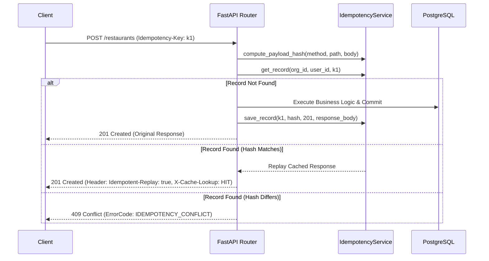

# FCD-07 §11 — Durable Idempotency Infrastructure

## 1. Motivation & Problem Statement

In distributed client-server environments, mutating operations (`POST`, `PUT`) can succeed server-side while failing to deliver the response due to network timeouts. When clients retry, naive implementations risk duplicate entities (e.g. duplicate restaurants, double charges, duplicate orders).

FCD-07 introduces durable, database-backed idempotency to guarantee that retransmitted requests return the exact same response without re-executing business logic.

---

## 2. Idempotency Invariants & Database Model

Records are persisted in the `idempotency_records` table:

```sql
CREATE TABLE idempotency_records (
    id UUID PRIMARY KEY,
    organization_id UUID NOT NULL REFERENCES organizations(id) ON DELETE CASCADE,
    actor_id UUID REFERENCES users(id) ON DELETE CASCADE,
    key VARCHAR(128) NOT NULL,
    request_hash VARCHAR(64) NOT NULL,
    response_status INTEGER NOT NULL,
    response_body JSONB,
    created_at TIMESTAMP WITH TIME ZONE DEFAULT CURRENT_TIMESTAMP NOT NULL,
    expires_at TIMESTAMP WITH TIME ZONE NOT NULL,
    CONSTRAINT uq_idempotency_org_actor_key UNIQUE (organization_id, actor_id, key)
);
```

- Keys are strictly scoped to `(organization_id, actor_id, key)`. A user in Org A cannot collide with or observe keys generated by Org B.
- PostgreSQL Row-Level Security (RLS) is enabled on `idempotency_records`.

---

## 3. Request Lifecycle & Payload Conflict Detection


