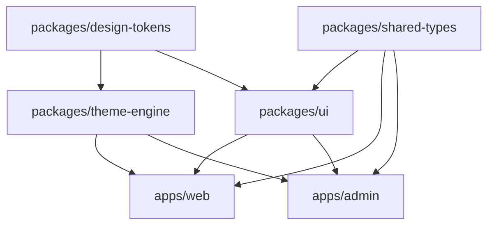

# FCD-08 §01 — Design System Architecture

## 1. System Overview

The Menu-It Design System provides the visual, structural, and interactive foundation for all user interfaces across the Menu-It multi-tenant platform. It powers both customer-facing interfaces (`apps/web` for diners and restaurant landing pages) and back-office administrative consoles (`apps/admin` for platform operations and organization management).

The design system architecture is structured across three decoupled monorepo packages and consumed by the Next.js applications:



---

## 2. Layered Architecture

The design system follows a strictly unidirectional dependency model:

### Layer 1: Design Tokens (`packages/design-tokens`)
- **Primitives:** Low-level scales for color palettes (slate, orange, zinc, emerald, amber, rose, sky), typography (font families, size steps, line heights, letter spacings, font weights), spacing units (4px grid), border radii, elevation shadows, transitions, and responsive breakpoints.
- **Semantic Mapping:** Contextual tokens mapping primitive scales to functional UI meanings: `--background`, `--foreground`, `--primary`, `--secondary`, `--muted`, `--accent`, `--destructive`, `--success`, `--warning`, `--border`, `--input`, `--ring`.
- **CSS Distribution:** Distributed as a unified CSS bundle (`@menu-it/design-tokens/index.css`) containing primitive and semantic CSS custom properties with automatic light and dark mode mappings.
- **TypeScript Mirrors:** Strong typed constants and TypeScript interfaces (`tokens.ts`, `css-variables.ts`) allowing runtime programmatic token access.

### Layer 2: Theme Engine (`packages/theme-engine`)
- **Theme Definition Model:** Strongly typed schema defining required colors, typography, and radii.
- **Validation Engine:** Strict schema validation verifying hex syntax, positive dimensions, and WCAG 2.2 AA contrast compliance (minimum 4.5:1 for normal text).
- **Runtime Application:** DOM injector writing CSS variables to root (`:root` or container scopes) with SSR protection.
- **Context & State:** Client-side React context provider (`ThemeProvider`) orchestrating light, dark, and system color scheme detection, local storage persistence, and scoped restaurant theme isolation (`data-restaurant-theme`).
- **Standard Presets:** Curated themes (`platformLight`, `platformDark`, `bistroClassic`, `modernMinimal`).

### Layer 3: Component Library (`packages/ui`)
- **Layout Primitives:** `Container`, `Grid`, `Stack` ensuring consistent responsive geometry, padding, and alignments.
- **Atomic Components:** `Button`, `Input`, `Badge`, `Avatar`, `Skeleton`.
- **Composite Components:** `Card` (with `Header`, `Title`, `Content`, `Footer`), `Table` (with `Header`, `Body`, `Row`, `Head`, `Cell`), `Dialog` (with `Header`, `Title`, `Description`, `Footer`), `Tabs` (with `List`, `Trigger`, `Panel`), `EmptyState`.
- **Accessibility & Focus:** Built-in ARIA roles, states, keyboard navigation, and consistent high-contrast focus rings (`3px solid var(--ring); outline-offset: 2px`).

### Layer 4: Application Shells (`apps/web` & `apps/admin`)
- Applications consume the design system via standard workspace package references (`workspace:*`).
- Applications define high-level layouts, routing, API orchestration, and server-side data fetching.
- Applications never redefine core button styles, token names, or arbitrary one-off color hexes.

---

## 3. Monorepo Integration

All packages reside within the Menu-It monorepo and are governed by `pnpm-workspace.yaml`:
```yaml
packages:
  - 'apps/*'
  - 'packages/shared-types'
  - 'packages/design-tokens'
  - 'packages/theme-engine'
  - 'packages/ui'
```

Next.js applications utilize `transpilePackages` to compile and bundle source code directly:
```javascript
// apps/web/next.config.mjs & apps/admin/next.config.mjs
const nextConfig = {
  reactStrictMode: true,
  transpilePackages: [
    '@menu-it/shared-types',
    '@menu-it/design-tokens',
    '@menu-it/theme-engine',
    '@menu-it/ui',
  ],
};
export default nextConfig;
```
