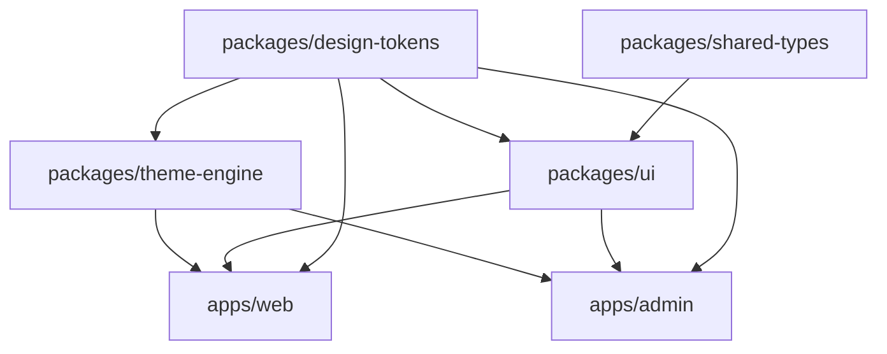

# FCD-08 §15 — Frontend Package Architecture

## 1. Package Monorepo Topology

```
packages/
├── shared-types/             # Domain and API types (FCD-06 / FCD-07)
│   ├── package.json
│   ├── tsconfig.json
│   └── src/index.ts
├── design-tokens/            # Visual tokens & CSS Custom Properties
│   ├── package.json
│   ├── tsconfig.json
│   └── src/
│       ├── primitives/       # Raw color, spacing, radius scales
│       ├── semantic/         # Functional light/dark theme CSS
│       ├── typography/       # Font families and fluid scales
│       ├── spacing/          # 4px grid CSS variables
│       ├── breakpoints/      # Media query breakpoint variables
│       ├── index.css         # Complete bundled CSS entrypoint
│       ├── tokens.ts         # TypeScript token mirror objects
│       └── index.ts          # Package JS/TS entrypoint
├── theme-engine/             # Theme resolution, validation & React provider
│   ├── package.json
│   ├── tsconfig.json
│   └── src/
│       ├── types/            # ThemeDefinition, ThemeMode, ThemeColors
│       ├── schemas/          # Theme schema & validateTheme()
│       ├── resolvers/        # contrast.ts & apply-theme.ts
│       ├── presets/          # Verified theme presets
│       ├── providers/        # ThemeProvider & useTheme hook
│       └── index.ts
└── ui/                       # Reusable accessible React component library
    ├── package.json
    ├── tsconfig.json
    └── src/
        ├── layouts/          # Container, Grid, Stack
        ├── components/       # Button, Input, Card, Badge, Table,
        │                     # Dialog, Tabs, Avatar, Skeleton, EmptyState
        └── index.ts
```

---

## 2. Package Boundaries & Dependency Graph



- `design-tokens` has zero runtime JavaScript dependencies.
- `theme-engine` depends only on React (`peerDependencies: ^18.0.0 || ^19.0.0`) and TypeScript.
- `ui` depends on React and the CSS variables provided by `design-tokens`.
- Applications depend on all three packages via `workspace:*` references in `package.json`.
