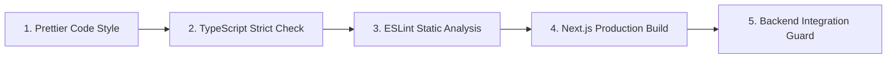

# FCD-08 §16 — Frontend Testing & Verification Strategy

## 1. Multi-Tier Verification Strategy

The frontend testing strategy for FCD-08 encompasses five automated validation gates:

---

## 2. Validation Execution Details

### Gate 1: Code Formatting (`pnpm format:check`)
Ensures uniform whitespace, quote consistency, trailing commas, and CSS formatting via Prettier across all monorepo packages.

### Gate 2: Strict Typechecking (`pnpm -r typecheck`)
Runs `tsc --noEmit` across all workspace projects:
- `@menu-it/shared-types`
- `@menu-it/design-tokens`
- `@menu-it/theme-engine`
- `@menu-it/ui`
- `@menu-it/web`
- `@menu-it/admin`
Validates type completeness, props contracts, and export signatures with zero errors.

### Gate 3: Next.js Linting (`pnpm -r lint`)
Runs `next lint` across `apps/web` and `apps/admin` enforcing Next.js App Router rules, React hooks dependencies, and accessibility heuristics.

### Gate 4: Production Build Verification (`pnpm build`)
Compiles production bundles for `apps/web` and `apps/admin`:
- Webpack bundling of monorepo packages via `transpilePackages`.
- Static page generation for `/`, `/_not-found`, and `manifest`.
- Bundle size analysis and verification of server-side component rendering.

### Gate 5: Backend Integration Guard (`python -m pytest apps/api/tests -q`)
Executes the full suite of 251 backend pytest tests to confirm that frontend package additions, workspace reconfigurations, and root dependencies caused zero regressions across the API.
