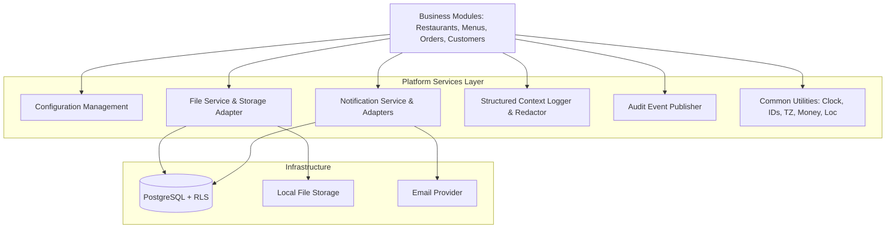

# FCD-09 §01 — Platform Services Architecture

## 1. Architectural Mission

The Menu-It platform services layer provides centralized, reusable, and secure cross-cutting capabilities across the modular monolith. It prevents business modules (such as restaurant locations, menus, modifiers, QR ordering, reservations, billing, and analytics) from independently reinventing configuration loading, file persistence, templating, notification dispatch, or time resolution.

---

## 2. Core Invariants

1. **Capabilities vs Decisions:** Platform services provide capabilities; business modules own business decisions.
2. **Tenant Identity Integrity:** Tenant identity is never resolved from an arbitrary upload body or JSON field. It is strictly derived from the validated `TenantContext`.
3. **Storage Path Hiding:** Internal filesystem paths and object storage keys are never exposed in public API responses or URLs.
4. **Independent Authorization:** File access authorization is verified independently from the upload process.
5. **No Premature Distributed Infrastructure:** FCD-09 provides synchronous provider contracts and in-memory/local adapters. Redis, queues, workers, and dead-letter topics belong strictly to FCD-10.
