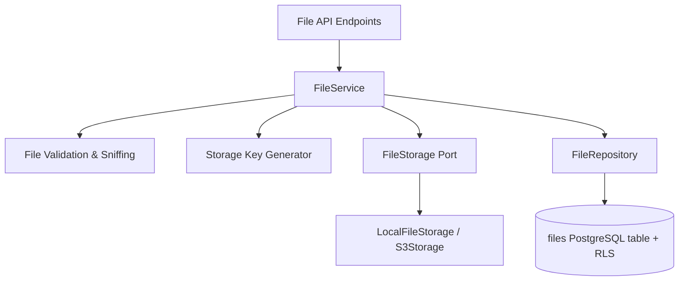

# FCD-09 §04 — File Service Architecture

## 1. File Lifecycle & Decoupled Layers

The file platform service separates storage mechanics, domain validation, database persistence, and API transport into independent layers:



---

## 2. Visibility Classifications

| Classification | Meaning | Authorization Rule |
| :--- | :--- | :--- |
| `PUBLIC` | Published menu items, restaurant logos | Publicly readable without credentials |
| `TENANT_PRIVATE` | Business records, internal contracts | Readable only by members of the owning organization |
| `USER_PRIVATE` | Staff IDs, tax documents | Readable only by the uploading user or platform admin |
| `PLATFORM_PRIVATE`| System diagnostic files, audit exports | Readable only by platform administrators |

---

## 3. Storage Key Generation

Storage keys are non-sequential, random hashes to prevent enumeration attacks:
```
organizations/{organization_id}/files/{file_id}/{uuid4().hex}{extension}
platform/files/{file_id}/{uuid4().hex}{extension}
```
Internal storage keys are never returned in public API payloads.
