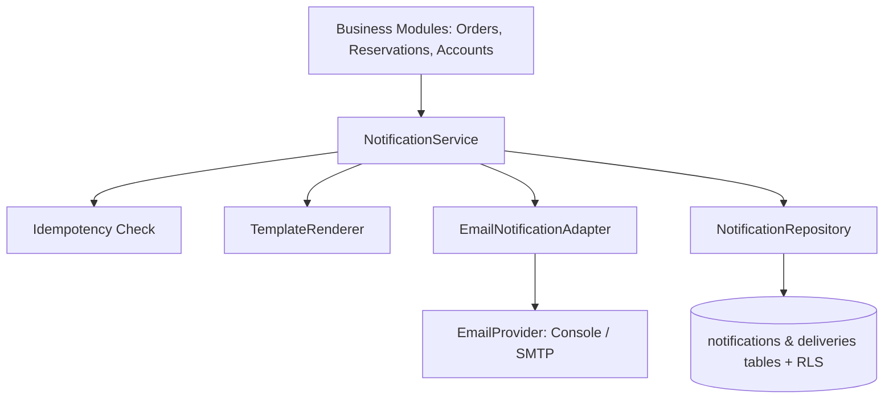

# FCD-09 §09 — Notification Architecture

## 1. Mission & Decoupled Architecture

The Notification subsystem (`menu_it.platform.notifications`) standardizes transactional messaging across email and in-app delivery channels.

---

## 2. Delivery States

| Status | Meaning |
| :--- | :--- |
| `PENDING` | Request received, queued for delivery |
| `ACCEPTED`| Adapter accepted request for dispatch |
| `SENT` | Provider accepted outbound message |
| `DELIVERED` | In-app notification persisted or delivery confirmed |
| `FAILED` | Provider or template rendering error |
| `CANCELLED`| Notification superseded or retracted |

---

## 3. Idempotency Guarantees

Every outbound notification requires an `idempotency_key`. If a request is received with an existing idempotency key, `NotificationService` returns the previously recorded delivery outcome rather than duplicating outbound emails or database records.
