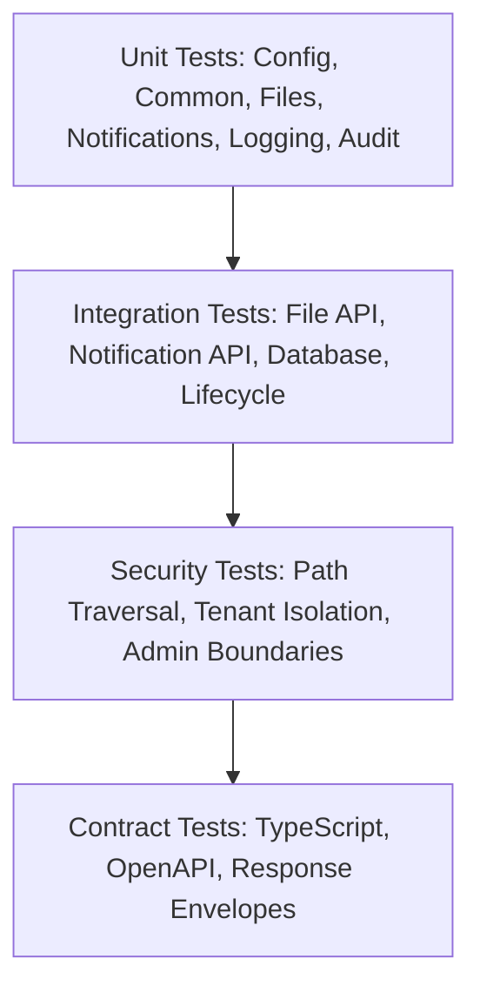

# FCD-09 §21 — Testing & Validation Strategy

## 1. Testing Pyramid

The testing strategy for FCD-09 encompasses four distinct test categories:

---

## 2. Test Catalog

- **Configuration:** Port bounds, wildcard CORS rejection, currency normalization, production debug guards.
- **Common Utilities:** System and frozen clock, UUID parsing, IANA timezone conversion, safe serialization, pagination bounds, locale fallbacks.
- **Logging & Redaction:** Sensitive key masking in nested mappings, structured JSON serialization, context logger binding.
- **Audit Contracts:** UTC awareness, immutability, metadata redaction, publisher dispatch.
- **File Service & Storage:** Magic-byte sniffing, filename sanitization, size limit enforcement, path traversal defense, authorization gates.
- **Notifications:** Autoescaped Jinja2 rendering, locale fallback, email dispatch, in-app persistence, delivery idempotency.
- **API Endpoints:** HTTP 201/200 lifecycle for file uploads and notifications, 404 on deleted objects, 403 on tenant violations.
- **Regression:** Zero regressions across all 251 pre-existing tests.
