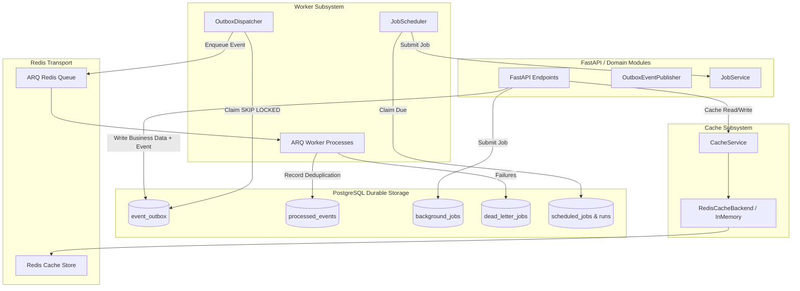

# FCD-10 — Architecture Overview & Data Flows

**Milestone:** `v1.0.0-fcd10`  
**Phase:** FCD-10 — Caching, Background Jobs & Event Infrastructure  
**Author:** AI Architecture & Core Engineering Team  
**Status:** Approved  

---

## 1. Logical Architecture

---

## 2. Reliability & Delivery Guarantees

1. **Transactional Outbox:** Business changes and event outbox rows are committed within the same PostgreSQL transaction. If the transaction rolls back, no event is ever published.
2. **At-Least-Once Delivery:** The dispatcher claims events via `FOR UPDATE SKIP LOCKED` and publishes them to workers.
3. **Idempotent Consumers:** The `processed_events` table enforces unique `(consumer_name, event_id)` insertion before running side effects.
4. **Decoupled Durability:** Redis serves as an execution transport and cache; PostgreSQL is the durable source of truth for jobs, outbox events, and dead letters.
