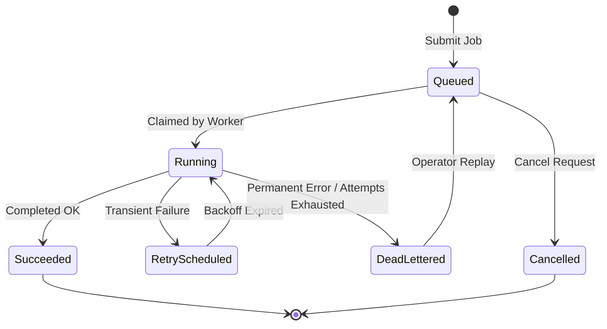

# FCD-10 — Background Job Architecture & Lifecycle

**Milestone:** `v1.0.0-fcd10`  
**Phase:** FCD-10 — Caching, Background Jobs & Event Infrastructure  
**Author:** AI Architecture & Core Engineering Team  
**Status:** Approved  

---

## 1. Job Lifecycle States

---

## 2. Job Envelope & Context

Defined in `menu_it.platform.jobs.contracts`:
- `JobContext`: Explicitly captures `organization_id`, `actor_user_id`, `correlation_id`, and `initiated_by`.
- `JobEnvelope`: Encapsulates `job_id`, `job_type`, `schema_version`, `payload`, `context`, `created_at`, and `idempotency_key`.
- Invariant: Never serialize database models, ORM sessions, or credentials into job payloads.
