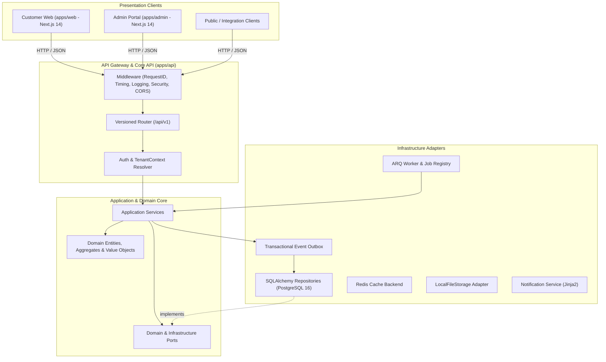

# FCD-13 · Document 01 — Integrated Architecture & Dependency Boundaries

## 1. Objective & Scope
This document specifies the integrated software architecture of the Menu-It platform across backend API services, asynchronous workers, frontend applications, and shared packages. It establishes strict Clean Architecture dependency boundaries verified by automated AST inspection.

---

## 2. Integrated Architectural Topology

---

## 3. Strict Module Dependency Rules

1. **Domain Purity (Inviolable):**
   - The domain package (`menu_it.domain.*`) MUST NOT import FastAPI, Starlette, SQLAlchemy, Redis, HTTPX, or Cloud SDKs.
   - Domain logic depends strictly on Python standard library modules (`decimal`, `datetime`, `zoneinfo`, `uuid`, `re`).
2. **Presentation Decoupling:**
   - API endpoints (`menu_it.api.v1.endpoints.*`) MUST NOT execute raw SQL or bypass application services.
   - Application services MUST NOT import HTTP request/response objects (`Request`, `Response`).
3. **Repository Abstraction:**
   - Persistence operations are declared as ports (`menu_it.domain.ports.*`) and implemented as SQLAlchemy adapters (`menu_it.infrastructure.repositories.*`).
4. **Automated Enforcement:**
   - Enforced by AST static analyzer test suite: `apps/api/tests/integration/test_architecture_boundaries.py`.
