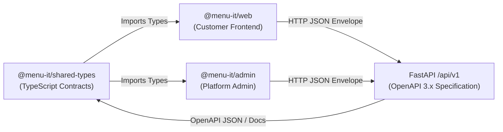

# FCD-13 · Document 05 — API, Frontend & Shared Contract Integration

## 1. Objective
Validates that the customer-facing web application (`apps/web`), platform administrative dashboard (`apps/admin`), and backend API (`apps/api`) communicate through a unified, versioned contract (`/api/v1`), governed by `@menu-it/shared-types`.

---

## 2. Shared Contract Architecture



---

## 3. Universal Response Envelope Standards

All responses conform to the FCD-02 / FCD-07 standardized API envelope:

### Success Envelope
```json
{
  "success": true,
  "data": { ... },
  "metadata": {
    "request_id": "2af5572e-8928-4a0a-88be-2c136ee32c78",
    "timestamp": "2026-11-26T04:30:00Z"
  }
}
```

### Error Envelope
```json
{
  "success": false,
  "error": {
    "code": "RESOURCE_NOT_FOUND",
    "message": "The requested restaurant profile could not be found.",
    "details": [
      {
        "field": "slug",
        "message": "Invalid slug identifier",
        "code": "INVALID_SLUG"
      }
    ]
  },
  "metadata": {
    "request_id": "2af5572e-8928-4a0a-88be-2c136ee32c78",
    "timestamp": "2026-11-26T04:30:00Z"
  }
}
```

---

## 4. Verification Matrix

| Test ID | Contract Scenario | Expected Outcome | Verification Status |
| :--- | :--- | :--- | :---: |
| `APIINT-01` | OpenAPI schema generation | Valid OpenAPI 3.x with title "Menu-It API" v0.1.0 | **PASSED** |
| `APIINT-02` | Client request ID propagation | Incoming UUID preserved; invalid strings sanitized | **PASSED** |
| `APIINT-03` | Response timing header | `X-Response-Time-MS` returned on all HTTP responses | **PASSED** |
| `APIINT-04` | Shared TypeScript alignment | `@menu-it/web` and `@menu-it/admin` pass `tsc --noEmit` | **PASSED** |
| `APIINT-05` | Health and telemetry routes | Registered in OpenAPI paths: `/health`, `/metrics` | **PASSED** |

---

## 5. Verification Evidence
Verified by:
- `apps/api/tests/integration/test_api_contract_integration.py`
- Monorepo TypeScript typecheck: `pnpm -r typecheck` (all 6 packages green).
