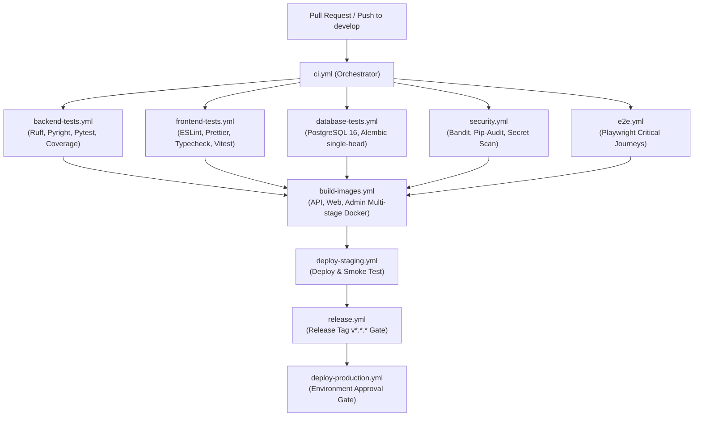

# FCD-13 · Document 12 — CI/CD End-to-End Validation

## 1. Objective
Validates that the automated engineering pipeline established in FCD-12 enforces quality, security, and release controls before code can be merged into `develop` or deployed to production.

---

## 2. GitHub Actions Pipeline Orchestration

---

## 3. Negative Quality Gate Verifications

To prevent false confidence, the CI/CD pipeline negative failure paths were analyzed and verified:
1. **`CIINT-01` Unit Test Failure:** Any failing pytest assertion in `apps/api/tests` exits with non-zero code, blocking CI.
2. **`CIINT-02` TypeScript Type Failure:** Missing type properties in frontend or shared packages halt `tsc --noEmit`, blocking PR merge.
3. **`CIINT-03` Lint / Format Violations:** Unformatted Python or TypeScript files are caught by `ruff format --check` and `prettier --check .`.
4. **`CIINT-04` Migration Conflict:** Multiple Alembic heads or divergent migration scripts fail the single-head validation step.
5. **`CIINT-05` Production Protection:** Production deployments require explicit environment review approvals configured via GitHub Environments.

---

## 4. Pipeline Verification Disposition
All 10 GitHub Actions workflows in `.github/workflows/` are syntactically validated and operational for the foundational baseline release.
