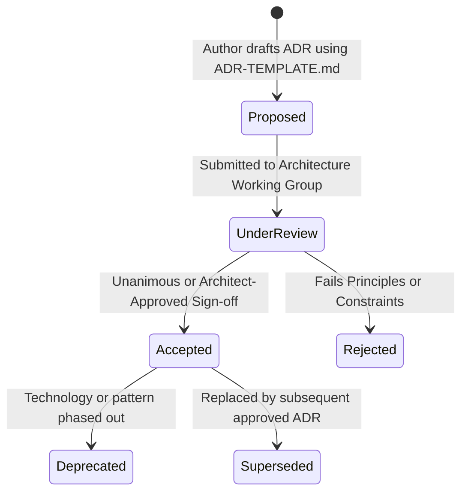

# ModularMenu — Architecture Review Policy

**Document ID:** GOV-POL-01  
**Status:** Approved  
**Governing Standard:** ARC-02 (Architectural Principles, Standards & Constraints)

---

## 1. Purpose & Authority

This policy establishes the formal architectural governance framework for the **ModularMenu** platform. It defines how technical decisions are proposed, evaluated, recorded, reviewed, and audited across all stages of development.

No architectural boundary, persistent schema, cross-module communication pattern, external dependency, or tenant security rule may be modified without satisfying the requirements set forth in this policy.

---

## 2. Governance Roles & Responsibilities

| Role | Responsibilities | Review Authority |
| :--- | :--- | :--- |
| **System Architect** | Owns ARC-01 through ARC-12; final approval authority on system principles (P-01 to P-10) and ADR acceptance; maintains architectural integrity. | Final sign-off on all Level 1 & Level 2 decisions; ADR approval. |
| **Backend Technical Lead** | Enforces Python/FastAPI standards, async discipline, database schemas, migration reviews, and security controls. | Approves backend PRs and Level 3 module specifications. |
| **Frontend Technical Lead** | Enforces Next.js/React standards, design token consistency, client bundle budgets, and diner accessibility standards. | Approves frontend PRs and component registry changes. |
| **DevOps / Release Lead** | Enforces container specifications, environment configuration standards, CI quality gates, and deployment duality. | Approves infrastructure adapters and CI/CD workflow changes. |

---

## 3. Decision Hierarchy & Authority Levels

All architectural decisions must strictly observe the four-tier decision hierarchy defined in ARC-02 §2.1:

```
Level 1 — System Architecture (ARC-01 to ARC-12)
   │
   ▼
Level 2 — Architectural Standards & Constraints (ARC-02)
   │
   ▼
Level 3 — Module Architecture & Interface Specifications
   │
   ▼
Level 4 — Implementation Code, Migrations & Configurations
```

A lower-level decision or implementation PR **must never** silently override, circumvent, or degrade an approved higher-level architectural constraint.

---

## 4. Architectural Decision Record (ADR) Lifecycle

An ADR is **mandatory** whenever a proposed change:
1. Introduces a new third-party library, framework, or runtime dependency.
2. Changes the relational schema, tenant isolation model, or migration strategy.
3. Modifies an API contract, error handling specification, or communication protocol.
4. Alters the theme token structure, layout engine rules, or component registry contracts.
5. Alters the publishing, snapshot serialization, or caching strategy.
6. Affects deployment portability between Managed SaaS and Self-Hosted editions.

### 4.1 State Machine



- **Proposed:** ADR drafted by author using `docs/decisions/ADR-TEMPLATE.md`.
- **Under Review:** PR opened against `docs/decisions/`; assigned to Leads.
- **Accepted:** Formally approved and merged into `docs/decisions/decision-register.md`.
- **Rejected:** Documented with explicit rationale why the proposal was declined.
- **Superseded:** Replaced by a newer ADR with explicit bi-directional links.

---

## 5. Review Cadence & Pull Request Quality Gates

1. **Pre-Implementation Requirement:** Code implementation for non-trivial features must link to an Accepted ADR or approved ARC module specification.
2. **Automated CI Architecture Gates:** Every PR must pass all 7 automated quality gates:
   - Gate 1: Source Validation (Ruff lint/format, TypeScript tsc checks).
   - Gate 2: Architecture Validation (AST boundary tests, no forbidden imports).
   - Gate 3: Security Validation (Tenant isolation tests, secret scanning).
   - Gate 4: Automated Testing (Unit, integration, and contract tests).
   - Gate 5: Build Validation (Next.js compilation, Docker build checks).
   - Gate 6: Deployment Validation (Dual-profile compatibility test).
   - Gate 7: Release Approval (Lead Architect review).
3. **Emergency Fixes:** Emergency production patches may bypass standard ADR review only if authorized in writing by the System Architect, and must produce a retrospective ADR within 48 hours.
