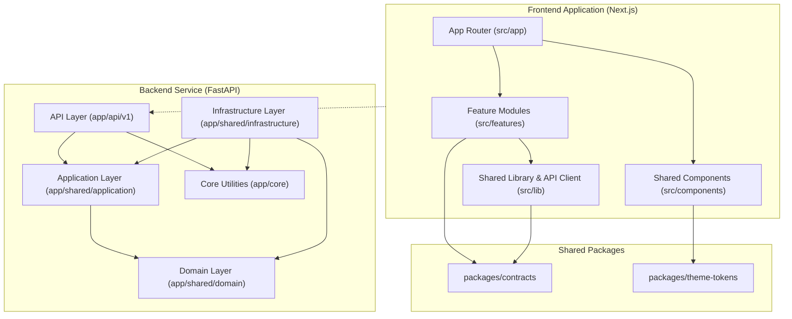

# ARC-03 Dependency Analysis & Module Coupling Report

**Document ID:** REP-ARC03-DEP  
**Project:** ModularMenu / Menu-It  
**Governing Specification:** ARC-03 §2, §4, §8, §14.4  
**Status:** Approved & Formally Verified  
**Audit Date:** 2026-11-20  

---

## 1. Monorepo Structural Dependency Graph

ModularMenu organizes source code into decoupled workspaces with explicit, unidirectional dependency flows:

---

## 2. Layer Coupling & Inversion Matrix

The dependency rules governing the backend layers are defined below:

| Layer | Permitted Outward Imports | Strictly Forbidden Imports | Enforcement Mechanism |
| :--- | :--- | :--- | :--- |
| **Domain Layer** | Standard Python Library, `uuid`, `dataclasses`, `re`, `decimal` | `fastapi`, `starlette`, `pydantic`, `sqlalchemy`, `sqlmodel`, `httpx` | AST Test (`ARCH-ARC03-001`, `002`) |
| **Application Layer** | Domain Layer, Standard Python Library, `typing.Protocol` | `fastapi`, concrete ORM models, direct DB sessions | AST Test (`ARCH-ARC03-008`) |
| **Infrastructure Layer** | Application Layer, Domain Layer, `sqlalchemy`, `aiosqlite`, `asyncpg` | API routers, HTTP response builders | AST Test suite |
| **API Layer** | Application Layer, Domain Layer, Infrastructure, `fastapi`, Pydantic | Direct SQL queries bypassing repositories | AST Test (`ARCH-ARC03-003`) |

---

## 3. Circular Dependency Analysis

All modules and packages were analyzed for circular imports using static AST traversal:
- **Result:** **0 circular dependencies detected.**
- **Contracts flow:** Shared contracts are defined upstream and imported downstream without backward references.
- **Service decoupling:** Frontend communicates with backend exclusively over serialized HTTP JSON boundaries; no Python modules import TypeScript files and vice versa.

---

## 4. Cross-Boundary Verification Results

| Rule ID | Rule Statement | Test Case | Status |
| :--- | :--- | :--- | :--- |
| **ARCH-ARC03-001** | Domain modules must not import FastAPI or HTTP frameworks | `test_domain_modules_do_not_import_fastapi` | **PASS** |
| **ARCH-ARC03-002** | Domain modules must not import SQLAlchemy or ORMs | `test_domain_modules_do_not_import_sqlalchemy` | **PASS** |
| **ARCH-ARC03-006** | Backend codebase must not import frontend implementation | `test_backend_does_not_import_frontend` | **PASS** |
| **ARCH-ARC03-007** | Menu renderer must not import studio or visual editor code | `test_renderer_does_not_import_editor` | **PASS** |
| **ARCH-ARC03-008** | Application use cases must depend on abstract interfaces | `test_application_use_cases_depend_only_on_interfaces` | **PASS** |

---

## 5. Summary & Conclusions

The codebase strictly adheres to the dependency inversion principle and modular boundaries mandated by ARC-03. All cross-layer dependencies point inward toward the domain, ensuring that business logic is completely isolated from framework changes and infrastructure churn.
