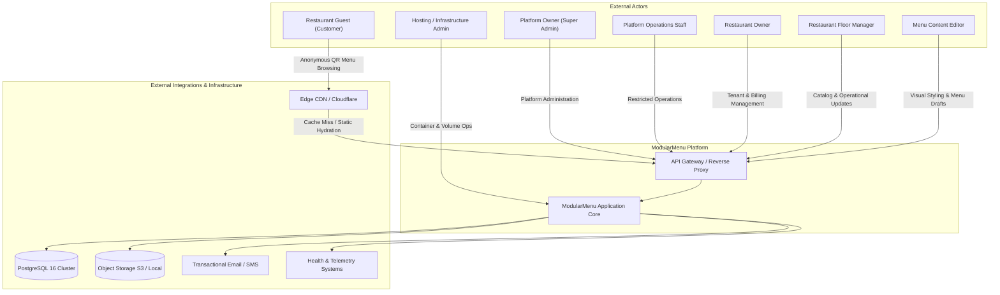
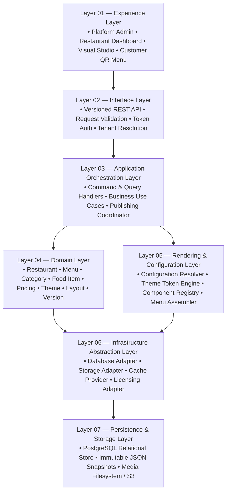

# ARC-01 — System Architecture Overview
**Document ID:** ARC-01  
**Status:** Approved Architectural Baseline  
**Classification:** Multi-Tenant Modular Digital Restaurant Menu Platform  
**Target Delivery:** Shared SaaS (Profile A) + Customer-Hosted Docker (Profile B)  
**System Identifier:** `ModularMenu`

---

## 1. System Identity & Vision

ModularMenu is a configurable, multi-tenant digital restaurant menu platform that enables restaurants to create, customize, publish, and maintain branded digital menu experiences through a reusable software framework.

The platform provides a centralized software foundation capable of serving multiple independent restaurants through declarative configuration rather than custom codebases. Each restaurant exercises sovereign control over its:
- Identity, brand typography, and visual palette.
- Menu structures (multi-menu: breakfast, lunch, dinner, seasonal, bar).
- Hierarchical food categories and food item catalogs.
- Pricing, portion variants, and optional/required add-ons.
- Food imagery, dietary badges (FSSAI-compliant Veg, Non-Veg, Egg, Vegan, Jain), and allergens.
- Visual themes, layout arrangements, and component visibility.
- Atomic publishing lifecycle and dynamic QR code generation.

The core architectural thesis is: **Configuration-driven restaurant menu experiences powered by an immutable, reusable application framework.**

---

## 2. System Context & External Actors

ModularMenu operates at the intersection of restaurant brand operators, kitchen/floor managers, dining guests, and cloud/on-premise infrastructure providers.

### Access Authorization Model
1. **Public Customer Access:** Anonymous, zero-authentication browsing of published immutable menu snapshots via `/r/[restaurantSlug]`.
2. **Tenant Operations Access:** Authenticated, cryptographically signed session tokens strictly bound to tenant roles (`owner`, `manager`, `menu_editor`, `viewer`).
3. **Platform Operations Access:** Super-admin privileges isolated from individual restaurant tenant data.

---

## 3. System Boundaries

To maintain long-term architectural stability, explicit functional boundaries are established:

### Inside the System Boundary (Core Product Scope)
- Restaurant organization and multi-branch tenancy management.
- Multi-menu scheduling, N-level category hierarchies, and food item cataloging.
- Multi-currency pricing models, portion sizing variants, and modifier add-on groups.
- Theme engine, design tokens, layout wireframes, and component registry.
- 3-panel interactive visual studio and form-based configuration editor.
- Customer-facing responsive mobile menu rendering engine.
- Transactional publishing engine with SHA-256 snapshot compilation and rollback.
- Dynamic high-resolution QR code generator (SVG / PNG).
- Hybrid hosting adapters (Managed multi-tenant SaaS profile vs. Customer-hosted container profile).
- Cryptographic licensing and entitlement engine for self-hosted editions.

### Outside the System Boundary (Non-Goals for Menu Platform Core)
- Real-time Point of Sale (POS) fiscal registers and cash drawer integration.
- Kitchen Order Ticketing (KOT) and order fulfillment pipelines.
- Payment gateway checkout processing (Razorpay, Stripe, UPI payments).
- Table reservations, waitlist queuing, and guest CRM.
- Third-party food delivery logistics dispatch (Swiggy, Zomato integrations).
- Restaurant staff payroll and inventory procurement ERP.

*Architectural Directive:* The system must not accidentally sprawl into a monolithic restaurant ERP. The boundary is strictly limited to menu creation, customization, publishing, and presentation. Future POS or transactional features will interface via decoupled webhooks or independent micro-services.

---

## 4. Seven-Layer High-Level Logical Architecture

---

## 5. Non-Negotiable Architecture Invariants

Future engineering designs and implementations must strictly adhere to these 10 invariants:
1. **Tenant Sovereignty:** One restaurant must never access, query, or mutate another restaurant's private data or drafts.
2. **Zero Code Forking:** Restaurant-specific visual individuality must be achieved exclusively through declarative configuration and design tokens, never via custom code branches or stylesheets.
3. **Domain Independence:** Menu content (dishes, descriptions, prices) and visual presentation (colors, typography, layout) must remain independently configurable.
4. **Renderer Isolation:** The customer-facing menu rendering engine must have zero runtime dependency on administration dashboard packages or internal database entities.
5. **Snapshot Immutability:** Once published, a menu version snapshot is frozen and immutable. Historical versions cannot be rewritten.
6. **Component Registry Allowlisting:** All visual components rendered on customer viewports must be allowlisted and validated against strict Pydantic / TypeScript schemas. Arbitrary user executable code injection is prohibited.
7. **Infrastructure Neutrality:** Core business logic must never bind directly to proprietary cloud provider services (e.g., AWS-only SDKs). Storage, mail, and database connections must operate behind swappable interfaces.
8. **Binary Codebase Duality:** The Managed SaaS and Customer-Hosted Docker editions must be built from the exact same codebase and container images.
9. **Privilege Separation:** Platform super-admin privileges must exist in an orthogonal authorization plane from restaurant tenant operational roles.
10. **Graceful Degradation:** The entire system must function with high reliability using only PostgreSQL and object storage; optional caches (Redis) must never be architectural single-points-of-failure.
