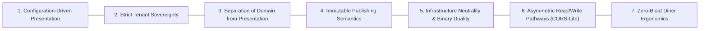
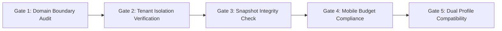

# ARC-02 — Architectural Principles, Standards & Design Constraints
**Document ID:** ARC-02  
**Status:** Approved Architectural Specification  
**Parent Document:** ARC-01 (System Architecture Overview)  
**System Identifier:** `ModularMenu`

---

## 1. Executive Purpose & Scope

This document establishes the governing engineering principles, technical standards, architectural boundaries, and non-negotiable constraints that apply across every module, interface, and deployment target of **ModularMenu**.

Every technical design, schema definition, API contract, and implementation decision must demonstrate compliance with the rules set forth in this document before approval.

---

## 2. Seven Governing Architectural Principles



### Principle 1: Configuration-Driven Presentation (Zero-Fork Rule)
No restaurant brand customization may ever be achieved by creating code forks, dedicated git branches, or custom CSS patches. Visual differentiation (color palettes, font pairings, spacing densities, border radiuses, layout structures) must be completely driven by declarative, schema-validated JSON configuration tokens interpreted at runtime by a unified menu rendering engine.

### Principle 2: Strict Tenant Sovereignty & Defense-in-Depth
Multi-tenant coexistence must be enforced across three independent defensive perimeters:
1. **Network / Ingress Perimeter:** API Gateway / Middleware resolves tenant identity from the cryptographic session token or URL path and halts unauthorized access with `HTTP 403 Forbidden`.
2. **Application / Query Perimeter:** Repository and service layers explicitly bind every tenant-scoped query to the active `restaurant_id`. Implicit cross-tenant queries are architecturally impossible.
3. **Database / Kernel Perimeter:** PostgreSQL Row-Level Security (RLS) policies act as the final backstop, denying row access when connection session attributes do not match the record's tenant ownership.

### Principle 3: Separation of Domain Catalog from Presentation Styling
The Catalog Domain (dishes, descriptions, dietary tags, allergen matrices, portion sizes, prices) is completely decoupled from the Presentation Domain (themes, fonts, card elevations, layout wireframes). 
- Changing a dish name or price must never invalidate or modify the restaurant's visual theme.
- Changing a visual theme must never mutate, duplicate, or alter menu item records.

### Principle 4: Immutable Publishing Semantics
Public diner traffic must never read directly from live, mutable draft records. Publishing a menu is an atomic compilation event that serializes the active catalog, pricing, theme, and layout configurations into a frozen, self-contained JSON snapshot stamped with a cryptographic SHA-256 checksum and a monotonically increasing version integer.
- Snapshots are write-once, read-many (WORM).
- Historical snapshots are permanently archived to guarantee instantaneous, zero-downtime rollback.

### Principle 5: Infrastructure Neutrality & Binary Duality
The platform exists in two delivery editions:
- **Profile A (Managed Multi-Tenant SaaS):** Centralized multi-tenant cloud infrastructure.
- **Profile B (Customer-Hosted Dedicated Appliance):** Standalone containerized deployment within customer-owned infrastructure.

*The Invariant:* Both profiles are compiled from the exact same codebase and execute identical container binaries. All infrastructure variations (PostgreSQL connection strings, local filesystem vs S3 object storage, SMTP vs mock mailers, local license verification) must be isolated behind pluggable infrastructure adapters governed by environment variables.

### Principle 6: Asymmetric Read/Write Pathways (CQRS-Lite)
The platform exhibits extreme read/write asymmetry:
- **Write Path (Low Volume, High Complexity):** Administrative actions (menu editing, theme styling, category reordering, price configuration) require complex relational consistency, validation, and authorization checks.
- **Read Path (Ultra-High Volume, Low Complexity):** Dining guests scanning QR codes at tables demand instantaneous (<1.5s) sub-second loading under fluctuating mobile network conditions. Public menu reads bypass relational joins entirely and query pre-compiled, edge-cacheable snapshots.

### Principle 7: Zero-Bloat Diner Ergonomics
The customer-facing menu interface is built for the dining room reality:
- **Zero Login Friction:** Diners are never prompted to sign up, log in, or install an app to browse food.
- **Ultra-Lightweight Footprint:** Strict JavaScript budget (<120 KB total bundle size).
- **Extreme Accessibility:** Full WCAG 2.1 AA compliance, high-contrast dietary indicators (FSSAI green/red/amber), touch target ergonomics (min 44×44px), and seamless operation on viewports down to 360px width.

---

## 3. Technology Boundaries & Module Responsibilities

The system enforces strict boundaries between its presentation, application, and persistence technologies:

```
+-------------------------------------------------------------------------+
| Next.js Frontend Framework (TypeScript)                                 |
| - Owns all presentation logic, interactive components, and routing.     |
| - Server Components render public customer menus to fast HTML.          |
| - Client Components manage the 3-panel Visual Studio state & draft.     |
| - Prohibited from executing direct database queries or raw SQL.         |
+-------------------------------------------------------------------------+
                                    |
                            Versioned REST API
                                    |
+-------------------------------------------------------------------------+
| FastAPI Application Core (Python 3.12)                                  |
| - Owns all business logic, authorization rules, and tenant validation.   |
| - Compiles and cryptographically hashes published menu snapshots.       |
| - Exposes OpenAPI contracts validated via Pydantic v2 schemas.          |
| - Prohibited from generating customer HTML or maintaining UI state.     |
+-------------------------------------------------------------------------+
                                    |
                        SQLAlchemy 2.0 Async ORM
                                    |
+-------------------------------------------------------------------------+
| PostgreSQL 16 & Relational Persistence                                 |
| - The single authoritative source of truth for all system data.         |
| - Enforces relational integrity, cascading deletions, and RLS policies. |
| - Stores immutable compiled snapshots in binary JSON (JSONB).           |
+-------------------------------------------------------------------------+
```

---

## 4. Engineering Standards & Conventions

### 4.1 Data & Monetary Precision Standards
1. **Currency Arithmetic:** Floating-point numbers (`float`, `double`) are strictly prohibited for monetary representation. All currency fields must use fixed-precision `NUMERIC(12,2)` or integer minor units (paise/cents).
2. **Temporal Standards:** All timestamps stored in the database must use UTC with explicit timezone offsets (`TIMESTAMPTZ` in PostgreSQL, `DateTime(timezone=True)` in Python). System clocks must never store or rely on local server time.
3. **Identifiers:** All persistent primary keys must be cryptographically secure Version 4 UUIDs (`uuid.UUID`), preventing enumeration attacks across multi-tenant boundaries. Slugs must be strictly alphanumeric with single hyphens (`^[a-z0-9]+(?:-[a-z0-9]+)*$`).

### 4.2 Backend & API Architecture Standards
1. **Async Discipline:** All database interactions and I/O operations must use native asynchronous calls (`async`/`await`). Synchronous blocking calls within API request lifecycles are forbidden.
2. **SQLAlchemy Loader Safety:** All relationship definitions must specify `lazy="raise"` or explicit `selectin` loading. Implicit lazy loading is strictly banned to prevent hidden $N+1$ query cascades and greenlet thread synchronization locks.
3. **API Contract Versioning:** All endpoints are versioned under `/api/v1/`. Breaking contract changes require a major version increment (`/api/v2/`).
4. **Error Handling & Problem Details:** All API error responses must adhere to the RFC 7807 specification:
   ```json
   {
     "type": "https://errors.modularmenu.in/errors/tenant-access-denied",
     "title": "Tenant Access Denied",
     "status": 403,
     "detail": "Caller does not possess administrative membership for restaurant 'the-bombay-canteen'.",
     "instance": "/api/v1/restaurants/a1b2c3d4/menus"
   }
   ```

### 4.3 Design Token & Styling Standards
1. **Token Hierarchy:** Visual styling is restricted to four token buckets:
   - `colors`: `surface`, `surfaceElevated`, `surfaceMuted`, `textPrimary`, `textMuted`, `primary`, `primaryForeground`, `accent`, `border`, `dietaryVeg`, `dietaryNonVeg`, `dietaryEgg`.
   - `typography`: `fontHeading`, `fontBody`, `fontPrice`, `baseSize`, `scaleRatio`.
   - `spacing`: `density` (`compact` | `comfortable` | `spacious`).
   - `borders`: `borderRadius` (`none` | `sm` | `md` | `lg` | `full`), `cardStyle` (`flat` | `bordered` | `elevated` | `glass`).
2. **Runtime Variable Injection:** All CSS values must resolve via standard CSS custom properties (`--theme-*`). The Next.js client dynamically updates CSS variables on the root preview element, achieving instantaneous styling updates without re-renders.

---

## 5. Architectural Anti-Patterns & Prohibitions

| Anti-Pattern | Consequence | Strict Architectural Remedy |
| :--- | :--- | :--- |
| **Bespoke Code Forking** | Maintenance nightmare; impossibility of rolling out global platform patches. | Enforce Principle 1: All styling must map to validated design tokens. |
| **Unbounded Querying** | Memory exhaustion and catastrophic database slowdowns during peak rushes. | Enforce server-side pagination (`limit`/`offset`) on all administrative lists. |
| **Database Joins on Diner Path** | Slow menu rendering and database connection pool exhaustion under QR scan spikes. | Serve frozen JSON snapshots directly from the `menu_versions` cache or Edge CDN. |
| **Implicit Tenant Inference** | Cross-tenant data leakage if header or URL parameter is spoofed. | Validate caller session membership against target tenant on every single protected route. |
| **Executable Plugin Uploads** | Remote code execution (RCE) and cross-site scripting (XSS) risks. | Allow only registered, compile-time verified React components in the Component Registry. |

---

## 6. Architecture Compliance & Quality Gates

Before any module, specification, or code package can be approved, it must pass five mandatory verification gates:



1. **Gate 1 (Domain Boundary Audit):** Does the module adhere strictly to menu management without ERP feature creep?
2. **Gate 2 (Tenant Isolation Verification):** Does the automated security test suite prove zero unauthorized cross-tenant data retrieval?
3. **Gate 3 (Snapshot Integrity Check):** Does the publishing engine produce deterministic, SHA-256 verifiable immutable snapshots?
4. **Gate 4 (Mobile Budget Compliance):** Does the public menu render in under 1.5s on mobile network simulation with Lighthouse 90+?
5. **Gate 5 (Dual Profile Compatibility):** Does the feature execute with identical behavior in both Managed SaaS and Customer-Hosted Docker environments?
