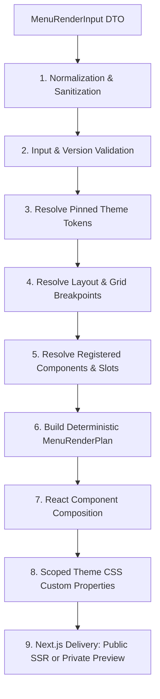

# ARC-09 — Menu Rendering Architecture
**Proposed Architecture Baseline · Version 1.0**  
**Project:** ModularMenu  
**Document ID:** ARC-09  
**Architecture Domain:** Menu Rendering, Presentation Composition and Public Menu Delivery  
**Depends On:** ARC-01 through ARC-08  
**Downstream Dependency:** ARC-10 — Publishing & Versioning Architecture  
**Primary Technologies:** Next.js, React, TypeScript, FastAPI, Python, PostgreSQL, JSON Schema, CSS Design Tokens  
**Architecture Style:** Modular monolith with independently deployable frontend and backend processes  

---

## 1. Executive Summary
ARC-09 defines how ModularMenu transforms restaurant content and visual customization into a fully rendered, responsive, publicly accessible digital menu.

It establishes the rendering system that connects:
- Restaurant and menu data.
- Categories, food items, prices and availability.
- ARC-08 theme, layout and component configuration.
- The registered component catalogue.
- Responsive layout rules.
- Media assets.
- Draft preview and published menu delivery.

The rendering architecture supports two principal experiences:
1. **Restaurant editing and preview:** An authenticated user previews an unpublished draft without exposing it publicly.
2. **Public menu delivery:** A customer opens a stable restaurant menu URL or QR code and receives the currently published menu.

The two experiences use the same core rendering rules while enforcing different data-access, authorization, caching and publication boundaries.

### 1.1 Primary Architectural Objective
Build a rendering engine that takes validated menu content and a resolved customization configuration and produces consistent output across mobile, tablet and desktop devices.
The engine is:
- Independent of restaurant dashboard implementation.
- Independent of database access.
- Driven by validated data and configuration.
- Compatible with versioned themes, layouts and components.
- Safe against executable configuration injection.
- Responsive and accessible.
- Efficient for public traffic.
- Portable between managed SaaS and customer-hosted deployments.

### 1.2 Boundary Mapping
| Responsibility | Governing Architecture |
| :--- | :--- |
| Restaurant identity and authentication | ARC-03 / ARC-05 |
| Menu content management | ARC-04 |
| Database entity design | ARC-06 |
| API contracts and authorization | ARC-07 |
| Theme, layout and component configuration | ARC-08 |
| Rendering and presentation composition | ARC-09 |
| Immutable publication and rollback | ARC-10 |
| Infrastructure, CDN and deployment | ARC-11 |
| Security, reliability and operational standards | ARC-12 |

---

## 2. Scope, Requirements and Invariants

### 2.1 Functional Requirements (P0 Baseline)
- `RND-F01`: Render restaurant identity and profile (P0).
- `RND-F02`: Render menu title and description (P0).
- `RND-F03`: Render categories and food items (P0).
- `RND-F04`: Render prices and currency formatting (P0).
- `RND-F05`: Render item availability state (P0).
- `RND-F06`: Apply resolved theme tokens (P0).
- `RND-F07`: Apply selected layout (P0).
- `RND-F08`: Render registered components (P0).
- `RND-F09`: Support responsive layouts (P0).
- `RND-F10`: Display approved menu media (P0).
- `RND-F11`: Render authenticated draft preview (P0).
- `RND-F12`: Render only published data publicly (P0).
- `RND-F13`: Support menu version pinning (P0).
- `RND-F14`: Support accessible navigation (P0).
- `RND-F15`: Support SEO and social metadata (P1).
- `RND-F16`: Support localization and regional formatting (P1).
- `RND-F17`: Support optional dietary/allergen labels (P1).
- `RND-F18`: Support analytics instrumentation (P2).

### 2.2 Non-Functional Performance & Quality Targets
- `RND-N01`: Cached public menu response: $p95 < 300\text{ ms}$.
- `RND-N02`: Normal menu rendering: $p95 < 500\text{ ms}$ SSR.
- `RND-N03`: Largest Contentful Paint (LCP): $< 2.5\text{ seconds}$.
- `RND-N04`: Cumulative Layout Shift (CLS): $< 0.1$.
- `RND-N05`: Interaction to Next Paint (INP): $< 200\text{ ms}$.
- `RND-N06`: Accessibility: WCAG 2.2 AA target.
- `RND-N07`: Mobile support: 360px and above.
- `RND-N08`: Public menu availability: 99.9% monthly target.
- `RND-N09`: Rendering determinism: Identical pinned inputs produce equivalent output.
- `RND-N10`: Tenant isolation: No unauthorized draft or private data exposure.

### 2.3 Core Rendering Invariants
1. Menu content and visual presentation remain separate.
2. The renderer never reads the database directly.
3. The renderer never trusts raw client configuration.
4. All components must exist in the approved component registry.
5. Every published menu references immutable content and configuration versions.
6. Public routes never expose draft data.
7. Draft preview must enforce authenticated tenant and resource authorization.
8. The same normalized configuration must produce consistent rendering behavior.
9. The rendering system must not execute restaurant-supplied JavaScript, HTML or arbitrary CSS.
10. Missing optional media must not cause the entire menu to fail.
11. Public rendering must not depend on the restaurant dashboard.
12. SaaS and customer-hosted deployments must share the same rendering behavior.

---

## 3. Rendering Architecture & Pipelines

### 3.1 Logical Rendering Pipeline

### 3.2 Canonical Rendering Input Contract
The renderer receives a single, validated DTO (`MenuRenderInput`):
- `metadata`: `render_mode` (`"published"` or `"preview"`), `snapshot_id`, `menu_id`, `locale`, `currency`, `schema_version`.
- `restaurant`: `name`, `slug`, `description`, `logo`, `cover_image`, `contact_information`.
- `menu`: `title`, `description`, `status`, `categories` with nested `items` (price in `amount_minor`, `availability`).
- `resolved_configuration`: Pinned `theme` (id, version, tokens), `layout` (id, version, responsive settings), `components` instances.
- `media_manifest`: Approved media assets with URLs, dimensions, and alt text.
- `publication`: `version`, `published_at`, `content_hash` (SHA-256).

### 3.3 Separate Public and Draft Models
To prevent accidental information leaks:
- `PublicMenuRenderResponse`: Excludes internal editor drafts, notes, moderation flags, and unapproved asset paths.
- `DraftMenuPreviewResponse`: Includes draft validation warnings and preview metadata, returned exclusively with `Cache-Control: private, no-store`.

---

## 4. Work Packages (WP-ARC09-01 to WP-ARC09-15)
- `WP-ARC09-01`: Rendering contracts and JSON Schemas (`packages/contracts/schemas/`).
- `WP-ARC09-02`: Input normalization, monetary formatting, and validation pipeline.
- `WP-ARC09-03`: Renderer core package (`packages/menu-renderer/`).
- `WP-ARC09-04`: ARC-08 theme integration and scoped CSS variable injection.
- `WP-ARC09-05`: ARC-08 layout integration and responsive breakpoint handling.
- `WP-ARC09-06`: Component rendering system and component renderer registry.
- `WP-ARC09-07`: Menu content composition and category navigation anchors.
- `WP-ARC09-08`: Pricing, localization, availability presentation, and media optimization.
- `WP-ARC09-09`: Backend render-input services (`backend/app/modules/rendering/`).
- `WP-ARC09-10`: Public menu delivery routes in Next.js (`/r/[restaurantSlug]/[menuSlug]`).
- `WP-ARC09-11`: Draft preview architecture and authorization guards.
- `WP-ARC09-12`: Caching strategy, ETag generation, SEO metadata, and QR stability.
- `WP-ARC09-13`: ARC-10 publication and rollback integration.
- `WP-ARC09-14`: Automated 120-test scenario catalogue (`ARC09-T001` to `ARC09-T120`).
- `WP-ARC09-15`: Architecture documentation deliverables (31 documents + technical guides).

---

## 5. Architectural Decisions (ADR-0141 to ADR-0167)
Detailed in Section 26 and formally appended to the repository decision register.
